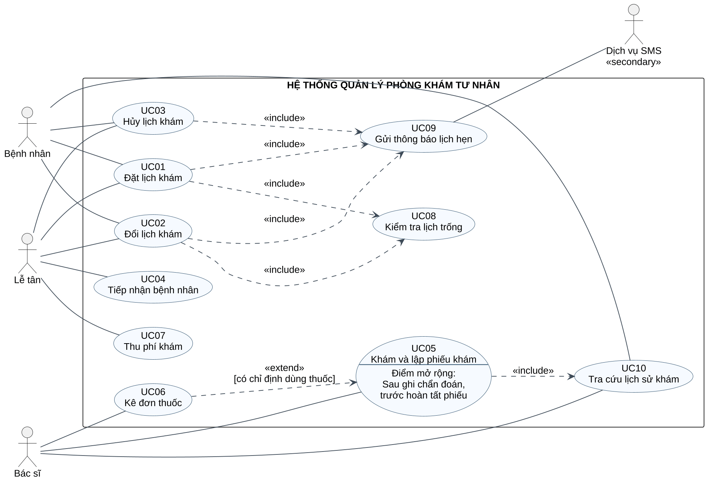

# 1. Mô tả bài toán (Project Brief)

**Lời kể của đại diện phòng khám — tình huống giả định phục vụ bài tập.** Các đoạn PB01–PB05 là căn cứ truy vết; đây không phải kết quả phỏng vấn một phòng khám thực tế.

**PB01 — Đặt và quản lý lịch hẹn.** “Phòng khám tư nhân của chúng tôi khám ngoại trú tại một cơ sở. Hiện lễ tân ghi lịch qua điện thoại và sổ, nên có lúc trùng giờ hoặc khó tìm lại thông tin. Chúng tôi muốn bệnh nhân tự đặt lịch trên hệ thống, hoặc nhờ lễ tân đặt hộ. Người đặt chọn bác sĩ, ngày và khung giờ còn trống, cung cấp thông tin nhận diện và số điện thoại. Lịch làm việc của bác sĩ được phòng khám cung cấp trước. Hệ thống phải kiểm tra chỗ trống khi xác nhận, tránh hai người cùng giữ một chỗ. Trước giờ hẹn, bệnh nhân có thể đổi hoặc hủy lịch chưa được tiếp nhận; lễ tân cũng hỗ trợ các việc này.”

**PB02 — Tiếp nhận.** “Khi bệnh nhân đến, lễ tân tìm lịch hẹn, đối chiếu thông tin và ghi nhận đã đến khám. Người chưa có lịch được lễ tân đặt vào khung giờ phù hợp còn chỗ trước khi tiếp nhận. Mỗi bệnh nhân cần có mã riêng, thông tin liên hệ và hồ sơ khám được lưu qua nhiều lần đến. Không được tạo hai lượt khám cho cùng một lịch hẹn. Lễ tân cần theo dõi danh sách chờ để hướng dẫn bệnh nhân đến đúng bác sĩ.”

**PB03 — Khám và kê đơn.** “Bác sĩ chọn người đang chờ mình khám, xem lịch sử khám nếu có, ghi triệu chứng, kết quả thăm khám, chẩn đoán và hướng xử trí vào phiếu khám. Nếu cần dùng thuốc, bác sĩ lập đơn có tên thuốc, hàm lượng, liều dùng, đường dùng, tần suất, thời gian dùng và số lượng. Có những lần khám chỉ tư vấn, không cần đơn thuốc. Khi hoàn tất, phiếu khám và đơn kèm theo được lưu trong hồ sơ bệnh nhân. Bệnh nhân được xem kết quả của chính mình đã hoàn tất; lễ tân không được xem nội dung chuyên môn.”

**PB04 — Thu phí.** “Sau khi khám xong, lễ tân thu phí khám bằng tiền mặt theo dịch vụ và bảng giá đã công bố. Hệ thống tạo phiếu thu gắn với lượt khám, cho biết số phải thu, số tiền nhận và tiền trả lại; chỉ ghi đã thanh toán khi lễ tân xác nhận đã nhận đủ. Mỗi lượt khám chỉ được thu một lần và có thể in lại phiếu thu. Phạm vi trước mắt chưa gồm bán thuốc, bảo hiểm y tế hay thanh toán trực tuyến.”

**PB05 — Thông báo và kiểm soát truy cập.** “Sau mỗi lần đặt, đổi hoặc hủy lịch thành công, hệ thống gửi thông tin tới số điện thoại bệnh nhân qua dịch vụ SMS bên ngoài. Nếu dịch vụ gặp lỗi, lịch hẹn vẫn phải được lưu đúng và lễ tân phải biết thông báo chưa gửi được để liên hệ. Bệnh nhân chỉ được truy cập dữ liệu của mình; nhân viên sử dụng tài khoản theo vai trò. Phòng khám cần bảo vệ hồ sơ và khôi phục được dữ liệu nếu xảy ra sự cố.”

\page

# 2. Phạm vi và quy tắc nghiệp vụ

## 2.1. Phạm vi và giả định

Đề tài số 6 tại Mục 2 của đề bài: bệnh nhân đặt lịch; bác sĩ khám và kê đơn; lễ tân quản lý lịch hẹn, thu phí. Tài liệu triển khai chi tiết theo Mục 4 (giai đoạn 1). Các quy tắc dưới đây là đề xuất của bài tập, cần nhóm rà soát và xác nhận với giảng viên.

- Một cơ sở, khám ngoại trú theo lịch; không mô hình hóa cấp cứu, nội trú, xét nghiệm, kho thuốc, bán thuốc, bảo hiểm, hoàn tiền hoặc báo cáo quản trị.
- Lịch làm việc, danh mục thuốc, dịch vụ và bảng giá được chuẩn bị sẵn; quản trị các danh mục và cấp tài khoản nằm ngoài phạm vi giai đoạn này.
- Bệnh nhân và nhân viên có tài khoản được cấp trước. Xác thực là điều kiện truy cập chung, không lặp thành quan hệ include ở từng Use Case.
- SMS là hệ thống bên ngoài được giả định bổ sung từ PB05 để đáp ứng nhu cầu thông báo và có Secondary Actor thực sự. Không gọi bác sĩ là Secondary chỉ vì ít sử dụng hệ thống.

## 2.2. Quy tắc nghiệp vụ

**BR01 — Khung giờ.** Mỗi khung giờ của một bác sĩ nhận tối đa một lịch đang hiệu lực. Lịch mới phải ở tương lai, thuộc lịch làm việc. Bệnh nhân không được có hai lịch hiệu lực giao nhau về thời gian; lịch đã hủy không chiếm chỗ.

**BR02 — Đổi/hủy.** Chỉ đổi hoặc hủy lịch ở trạng thái Đã xác nhận và trước giờ bắt đầu. Đổi lịch phải giữ được chỗ mới và nhả chỗ cũ trong cùng một lần cập nhật; nếu thất bại, giữ nguyên lịch cũ. Giữ nguyên mã lịch khi đổi.

**BR03 — Nhận diện và tiếp nhận.** Mã bệnh nhân là định danh; số điện thoại có thể dùng chung nên không làm khóa duy nhất. Lễ tân đối chiếu họ tên, ngày sinh và số điện thoại; trường hợp trùng thông tin cần xác nhận thêm, không tự gộp hồ sơ. Tiếp nhận trong ngày hẹn; một lịch chỉ sinh một lượt khám.

**BR04 — Trạng thái.** Lịch hẹn: Đã xác nhận → Đã tiếp nhận hoặc Đã hủy. Lượt khám: Chờ khám → Đang khám → Hoàn tất. Thanh toán được theo dõi riêng: Chưa thu → Đã thu. Lịch quá giờ chưa tiếp nhận được đánh dấu quá giờ khi hiển thị, không tự coi đã khám.

**BR05 — Phiếu khám và đơn thuốc.** Bác sĩ được phân công mới cập nhật lượt khám. Chẩn đoán và hướng xử trí bắt buộc khi hoàn tất. Một phiếu khám có tối đa một đơn thuốc, gồm nhiều dòng thuốc; không cần thuốc thì không tạo đơn. Bản nháp có thể sửa; hồ sơ đã hoàn tất chỉ được xem trong phạm vi bài tập.

**BR06 — Thu phí.** Mỗi lượt khám áp dụng một dịch vụ khám; phí được chốt theo giá có hiệu lực khi tiếp nhận và lưu cùng lượt khám. Chỉ thu khi lượt khám Hoàn tất; một lượt có tối đa một phiếu thu hợp lệ, không thu một phần. Tiền trả lại = tiền nhận − phí khám.

**BR07 — Thông báo.** Đặt/đổi/hủy thành công luôn thực hiện bước yêu cầu gửi SMS. Lỗi SMS không hoàn tác lịch hẹn; lưu trạng thái gửi và lý do lỗi. Không gửi chẩn đoán hoặc thuốc trong SMS.

\page

# 3. Danh sách yêu cầu

## 3.1. Yêu cầu chức năng

Mỗi yêu cầu mô tả hành vi có thể kiểm tra. Cột nguồn chỉ về Project Brief và Use Case thực hiện; các quy tắc BR tại Mục 2 bổ sung điều kiện xử lý.

| Mã | Nội dung và tiêu chí chấp nhận | Nguồn / Use Case |
| --- | --- | --- |
| FR01 | Hiển thị các khung giờ còn trống theo bác sĩ và ngày; loại khung đã qua, ngoài giờ làm việc hoặc đã có lịch hiệu lực. Kiểm tra lại khi lưu. | PB01 / UC08 |
| FR02 | Bệnh nhân đặt lịch cho mình; lễ tân đặt hộ. Khi hợp lệ, tạo mã lịch duy nhất, gắn bệnh nhân, bác sĩ, giờ hẹn, trạng thái Đã xác nhận. | PB01 / UC01 |
| FR03 | Cho phép chủ lịch hoặc lễ tân đổi lịch theo BR02. Đổi thành công giữ mã lịch; thất bại giữ nguyên chỗ cũ, không phát sinh lịch thứ hai. | PB01 / UC02 |
| FR04 | Cho phép chủ lịch hoặc lễ tân hủy theo BR02; lưu lý do, thời điểm và người hủy, giải phóng chỗ. Lịch đã hủy được giữ để tra cứu. | PB01 / UC03 |
| FR05 | Tìm hồ sơ theo mã hoặc thông tin nhận diện. Lễ tân xác minh hồ sơ có sẵn hoặc tạo mã bệnh nhân mới khi đặt hộ; không tự gộp người trùng tên/số điện thoại. | PB02 / UC01, UC04 |
| FR06 | Tiếp nhận lịch hợp lệ, ghi giờ đến, tạo đúng một lượt Chờ khám với bác sĩ và phí đã chốt. Hiển thị hàng chờ của từng bác sĩ theo giờ tiếp nhận. | PB02 / UC04 |
| FR07 | Cho bác sĩ được phân công xem lịch sử bệnh nhân đang khám; cho bệnh nhân xem các phiếu và đơn đã hoàn tất của chính mình. Không có lịch sử thì trả danh sách rỗng. | PB03 / UC10 |
| FR08 | Bác sĩ ghi và lưu nháp triệu chứng, kết quả khám, chẩn đoán, hướng xử trí; chỉ hoàn tất khi đủ nội dung bắt buộc. Hồ sơ hoàn tất gắn đúng lượt và bệnh nhân. | PB03 / UC05 |
| FR09 | Khi có chỉ định, bác sĩ kê đơn với ít nhất một dòng thuốc đầy đủ tên, hàm lượng, liều, đường dùng, tần suất, thời gian và số lượng dương; lưu cùng phiếu khám. | PB03 / UC06 |
| FR10 | Lễ tân xem phí đã chốt, nhập tiền nhận; hệ thống tính tiền trả lại. Chỉ xác nhận đã thu khi đủ tiền và tạo đúng một phiếu thu cho lượt khám. | PB04 / UC07 |
| FR11 | Cho lễ tân xem/in lại phiếu thu gồm mã, bệnh nhân, lượt khám, dịch vụ, phí, tiền nhận, tiền trả lại, thời điểm và người thu; in lại không tạo khoản thu mới. | PB04 / UC07 |
| FR12 | Sau đặt/đổi/hủy thành công, gọi dịch vụ SMS và lưu kết quả gửi gắn với lịch hẹn. Khi lỗi, hiển thị cảnh báo cho lễ tân và vẫn giữ lịch đã cập nhật. | PB05 / UC09 |

\page

## 3.2. Yêu cầu phi chức năng

Các ngưỡng dưới đây là mục tiêu nghiệm thu đề xuất cho bài tập, chưa phải số liệu đo của phòng khám. Kiểm thử dùng dữ liệu giả lập, không dùng hồ sơ người bệnh thật.

| Mã | Yêu cầu và cách kiểm chứng |
| --- | --- |
| NFR01 — Phân quyền | Mọi thao tác đọc/ghi phải kiểm tra danh tính và quyền phía máy chủ. Bệnh nhân chỉ xem dữ liệu mình; bác sĩ xem bệnh nhân được phân công và cập nhật lượt của mình; lễ tân xem nhận diện, lịch, phí nhưng không xem chẩn đoán/đơn. Kiểm tra bằng truy cập chéo mã hồ sơ giữa các tài khoản; mọi truy cập trái quyền phải bị từ chối. |
| NFR02 — Bảo mật | Truyền dữ liệu qua HTTPS; mật khẩu chỉ lưu dạng băm một chiều có salt. Nhật ký vận hành không chứa mật khẩu, nội dung bệnh án hoặc đơn thuốc. Kiểm tra cấu hình, dữ liệu lưu và mẫu log trước nghiệm thu. |
| NFR03 — Hiệu năng | Với 20 người dùng đồng thời và 10.000 lịch hẹn giả lập, ít nhất 95% thao tác tra cứu lịch/hồ sơ trả kết quả trong 2 giây; lưu nghiệp vụ trong 3 giây, không tính thời gian dịch vụ SMS bên ngoài. Đo từ yêu cầu đến phản hồi trong môi trường kiểm thử thống nhất. |
| NFR04 — Nhất quán | Khi hai yêu cầu cùng đặt một khung giờ, chỉ một được thành công. Gửi lặp yêu cầu tiếp nhận/thu phí không tạo thêm lượt/phiếu thu. Kiểm thử đồng thời và gửi lại yêu cầu sau giả lập mất kết nối. |
| NFR05 — Khôi phục | Sao lưu dữ liệu ít nhất mỗi ngày; mục tiêu mất dữ liệu tối đa 24 giờ và khôi phục trong 4 giờ từ bản sao lưu khả dụng. Chứng minh bằng một lần phục hồi thử và đối chiếu số lượng, liên kết hồ sơ. |
| NFR06 — Dễ sử dụng | Giao diện tiếng Việt, ngày dd/MM/yyyy, giờ 24 giờ, tiền VND; trường bắt buộc được đánh dấu, lỗi chỉ rõ trường cần sửa. Các thao tác chính dùng được bằng bàn phím, có nhãn nhập liệu và trạng thái không chỉ thể hiện bằng màu. |
| NFR07 — Khả năng kiểm tra | Ghi người thao tác, thời điểm, mã đối tượng, loại hành động và kết quả cho đặt/đổi/hủy, tiếp nhận, hoàn tất khám, thu phí. Tài khoản nghiệp vụ không sửa/xóa nhật ký; thử một thao tác mỗi loại và đối chiếu bản ghi. |
| NFR08 — Cô lập lỗi SMS | Yêu cầu gửi SMS có thời gian chờ tối đa 5 giây; lỗi hoặc quá hạn phải được ghi nhận mà không làm mất lịch đã lưu. Thử dịch vụ giả lập lỗi và kiểm tra lịch vẫn còn, trạng thái gửi thể hiện rõ. |

Nguồn: PB05 cho bảo mật, khôi phục và thông báo; PB01–PB04 cho tính nhất quán. Các ngưỡng hiệu năng và tiêu chí giao diện là giả định bổ sung để biến yêu cầu chất lượng thành điều kiện kiểm chứng được.

\page

# 4. Mô hình Use Case

## 4.1. Tác nhân và ranh giới hệ thống

| Tác nhân | Loại | Mục tiêu / vai trò | Nguồn |
| --- | --- | --- | --- |
| Bệnh nhân | Primary | Đặt, đổi, hủy lịch của mình; xem kết quả khám đã hoàn tất. | PB01, PB03 |
| Lễ tân | Primary | Đặt/đổi/hủy hộ bệnh nhân, xác minh hồ sơ, tiếp nhận và thu phí. | PB01, PB02, PB04 |
| Bác sĩ | Primary | Xem lịch sử, khám, lập phiếu khám và kê đơn khi cần. | PB03 |
| Dịch vụ SMS | Secondary | Nhận yêu cầu gửi tin và trả kết quả tiếp nhận/lỗi cho hệ thống. Không chủ động đặt lịch. | PB05 |

Primary Actor khởi xướng mục tiêu nghiệp vụ; Secondary Actor cung cấp dịch vụ cho hệ thống. Một con người có thể đảm nhiệm nhiều vai trò, nhưng sơ đồ thể hiện vai trò tương tác. Cơ sở dữ liệu và máy in cục bộ không được thêm thành tác nhân độc lập trong mô hình này.

## 4.2. Danh mục Use Case

| Mã | Tên | Tác nhân trực tiếp | Kết quả |
| --- | --- | --- | --- |
| UC01 | Đặt lịch khám | Bệnh nhân, Lễ tân | Lịch được xác nhận hoặc lý do từ chối. |
| UC02 | Đổi lịch khám | Bệnh nhân, Lễ tân | Lịch chuyển sang khung mới còn chỗ. |
| UC03 | Hủy lịch khám | Bệnh nhân, Lễ tân | Lịch đã hủy, khung giờ được giải phóng. |
| UC04 | Tiếp nhận bệnh nhân | Lễ tân | Một lượt khám được đưa vào hàng chờ. |
| UC05 | Khám và lập phiếu khám | Bác sĩ | Phiếu khám hoàn tất, có hoặc không có đơn. |
| UC06 | Kê đơn thuốc | Bác sĩ | Đơn thuốc hợp lệ gắn với phiếu khám. |
| UC07 | Thu phí khám | Lễ tân | Phiếu thu hợp lệ, lượt khám đã thu phí. |
| UC08 | Kiểm tra lịch trống | Qua UC01, UC02 | Kết quả kiểm tra bác sĩ/khung giờ hợp lệ. |
| UC09 | Gửi thông báo lịch hẹn | Dịch vụ SMS hỗ trợ | Kết quả gửi được ghi nhận. |
| UC10 | Tra cứu lịch sử khám | Bệnh nhân, Bác sĩ | Lịch sử được lọc đúng quyền truy cập. |

UC08 và UC09 là hành vi dùng chung, được kích hoạt trong Use Case khác; không phải mục tiêu người dùng phải thao tác riêng. UC10 có thể được gọi trong UC05 hoặc được người dùng có quyền tra cứu trực tiếp.

\page

## 4.3. Use Case Diagram

**Hình 1.** Ranh giới hệ thống bao quanh 10 Use Case; bốn tác nhân nằm ngoài. Đường liền là association, đường nét đứt có mũi tên là quan hệ include/extend. Sơ đồ được xuất từ PlantUML, kèm mã nguồn để chỉnh sửa.

\page

## 4.4. Giải thích các quan hệ UML

**Include — hành vi luôn được thực hiện trong luồng có điều kiện phù hợp.** Mũi tên đi từ Use Case sử dụng tới Use Case được bao gồm:

- UC01 → UC08: đặt lịch phải kiểm tra giờ làm việc và chỗ trống; kiểm tra lại tại thời điểm ghi nhận để tránh tranh chấp.
- UC02 → UC08: đổi lịch phải kiểm tra khung mới trước khi thay thế lịch hiện tại.
- UC01, UC02, UC03 → UC09: mỗi thay đổi lịch thành công đều yêu cầu gửi thông báo. Lần đặt/đổi/hủy bị từ chối không tạo sự kiện thành công nên không đến bước gửi.
- UC05 → UC10: trước khi ghi kết quả khám, hệ thống luôn lấy lịch sử cho bác sĩ kiểm tra; bệnh nhân mới nhận kết quả rỗng vẫn là đã thực hiện UC10.

**Extend — bổ sung có điều kiện.** UC06 → UC05, điều kiện [có chỉ định dùng thuốc]; điểm mở rộng là “Sau ghi chẩn đoán, trước hoàn tất phiếu”. Bác sĩ chỉ kê đơn khi cần, nên UC05 tự hoàn thành được nếu không có đơn. Mũi tên xuất phát từ Use Case mở rộng UC06 và trỏ vào Use Case cơ sở UC05.

**Không dùng include để diễn tả thứ tự công việc.** Tiếp nhận, khám và thu phí liên hệ qua tiền/hậu điều kiện cùng trạng thái dữ liệu. UC04 không include UC05, UC05 không include UC07, vì đó là những mục tiêu độc lập của các tác nhân khác nhau.

## 4.5. Luồng tóm tắt các Use Case hỗ trợ

**UC02 — Đổi lịch:** Xác thực chủ lịch hoặc vai trò lễ tân → chọn lịch → kiểm tra BR02 → chọn khung mới → UC08 → xác nhận → cập nhật nguyên tử theo BR02 → UC09. Nếu khung mới bị chiếm hoặc cập nhật lỗi, giữ lịch cũ. Không đổi sang khung đang giữ; hệ thống báo không có thay đổi.

**UC03 — Hủy lịch:** Xác thực quyền → chọn lịch → kiểm tra BR02 → nhập lý do và xác nhận → đổi trạng thái Đã hủy, nhả chỗ → UC09. Nếu đã tiếp nhận/quá giờ, từ chối; nếu đã hủy, trả trạng thái hiện tại, không gửi thêm tin cho cùng thao tác.

**UC08 — Kiểm tra lịch trống:** Nhận bệnh nhân, bác sĩ, khung giờ và mã lịch đang đổi (nếu có) → kiểm tra lịch làm việc, thời điểm, lịch bác sĩ và lịch bệnh nhân theo BR01 → trả hợp lệ hoặc lý do. Khi đổi, bỏ qua chính lịch đang được thay thế; kiểm tra phải có hiệu lực tại lúc lưu.

**UC09 — Gửi thông báo:** Nhận sự kiện lịch đã lưu → tạo nội dung gồm mã lịch, hành động, bác sĩ và giờ liên quan → gửi qua dịch vụ SMS → ghi kết quả. Nhà cung cấp chấp nhận yêu cầu chỉ được ghi “Đã chuyển nhà cung cấp”, không đồng nghĩa điện thoại đã nhận. Lỗi/quá hạn ghi “Gửi lỗi” hoặc “Chưa xác định”, cảnh báo lễ tân; không tự gửi lặp khi chưa rõ kết quả.

**UC10 — Tra cứu lịch sử:** Kiểm tra quyền theo NFR01 → tìm hồ sơ → trả các phiếu và đơn đã hoàn tất được phép xem. Không có dữ liệu thì hiển thị “Chưa có lịch sử khám”; truy cập trái quyền bị từ chối và không tiết lộ hồ sơ.

\page

# 5. Đặc tả Use Case

## 5.1. UC01 — Đặt lịch khám

**1. Tên:** UC01 — Đặt lịch khám. Mục tiêu: tạo lịch hợp lệ, không trùng chỗ. Truy vết: PB01, PB02, PB05; FR01, FR02, FR05, FR12; BR01, BR03, BR07.

**2. Actor:** Chính: Bệnh nhân hoặc Lễ tân (đặt hộ). Hỗ trợ: Dịch vụ SMS qua UC09.

**3. Tiền điều kiện:** Actor đã xác thực, có quyền đặt lịch. Lịch làm việc của bác sĩ đã có. Bệnh nhân tự đặt dùng hồ sơ gắn tài khoản; lễ tân có thể xác minh hoặc tạo hồ sơ ở bước 2.

**4. Luồng chính:**

1. Actor chọn chức năng đặt lịch khám.
2. Hệ thống xác định hồ sơ bệnh nhân; lễ tân tìm theo mã hoặc thông tin nhận diện và đối chiếu họ tên, ngày sinh, số điện thoại. Nếu người mới, nhập thông tin bắt buộc để tạo hồ sơ cùng giao dịch đặt lịch.
3. Actor chọn bác sĩ và ngày; hệ thống thực hiện UC08 và hiển thị các khung giờ còn chỗ.
4. Actor chọn khung giờ, nhập lý do khám ngắn và kiểm tra số điện thoại nhận thông báo.
5. Hệ thống hiển thị bản tóm tắt: bệnh nhân, bác sĩ, ngày giờ, lý do khám. Actor xác nhận.
6. Hệ thống kiểm tra dữ liệu, quyền và kiểm tra lại UC08; lưu lịch Đã xác nhận với mã duy nhất, gắn đúng hồ sơ. Việc chiếm chỗ và lưu lịch là một giao dịch.
7. Hệ thống gọi UC09 để gửi thông báo và ghi kết quả gửi.
8. Hệ thống hiển thị mã lịch, giờ hẹn và kết quả yêu cầu gửi thông báo.

**5. Luồng phụ/Ngoại lệ:**

- A1 — Tại bước 2, nhiều hồ sơ gần giống: yêu cầu lễ tân đối chiếu mã và thông tin bổ sung; không tự chọn hoặc gộp. Chưa xác định được thì dừng, không tạo lịch.
- A2 — Tại bước 4–6, thiếu/sai thông tin: chỉ rõ trường lỗi, cho sửa và quay lại bước tương ứng; chưa ghi lịch.
- A3 — Tại bước 3 hoặc 6, hết chỗ, trùng lịch bệnh nhân, ngoài giờ hoặc thời điểm đã qua: thông báo lý do; chọn khung khác ở bước 3.
- A4 — Tại bước 5, Actor hủy thao tác: kết thúc, không tạo hồ sơ/lịch từ dữ liệu chưa xác nhận.
- E1 — Tại bước 6, ghi dữ liệu thất bại: hoàn tác toàn bộ giao dịch, không giữ chỗ. Nếu chỉ mất phản hồi, tra lại theo mã yêu cầu trước khi gửi lại; không tạo lịch trùng.
- E2 — Tại bước 7, SMS lỗi/quá hạn: ghi trạng thái và cảnh báo lễ tân; tiếp tục bước 8, lịch vẫn hợp lệ.

**6. Hậu điều kiện:** Thành công: có đúng một lịch Đã xác nhận, một chỗ được giữ, hồ sơ được liên kết và kết quả gửi được ghi. Thất bại trước khi lưu: không có lịch/chỗ mới. Lỗi SMS sau khi lưu không làm thay đổi kết quả đặt lịch.

\page

## 5.2. UC04 — Tiếp nhận bệnh nhân

**1. Tên:** UC04 — Tiếp nhận bệnh nhân. Mục tiêu: đưa đúng bệnh nhân vào hàng chờ của bác sĩ. Truy vết: PB02, PB04; FR05, FR06; BR03, BR04, BR06.

**2. Actor:** Chính: Lễ tân. Bệnh nhân cung cấp thông tin trực tiếp tại quầy, không thao tác hệ thống trong Use Case này.

**3. Tiền điều kiện:** Lễ tân đã xác thực và có quyền tiếp nhận. Bệnh nhân có lịch Đã xác nhận trong ngày; dịch vụ khám và bảng giá hợp lệ đã có.

**4. Luồng chính:**

1. Lễ tân chọn tiếp nhận, nhập mã lịch hoặc thông tin tìm kiếm.
2. Hệ thống trả danh sách phù hợp, gồm mã bệnh nhân, họ tên, ngày sinh, giờ hẹn, bác sĩ và trạng thái lịch.
3. Lễ tân chọn đúng lịch, đối chiếu thông tin với người đến khám; xác nhận danh tính và dịch vụ khám áp dụng.
4. Hệ thống kiểm tra lại ngày, trạng thái lịch, chưa có lượt khám và lấy mức phí dịch vụ có hiệu lực tại thời điểm tiếp nhận.
5. Hệ thống hiển thị bác sĩ, dịch vụ và phí sẽ chốt; lễ tân xác nhận tiếp nhận.
6. Hệ thống đồng thời chuyển lịch thành Đã tiếp nhận và tạo một lượt Chờ khám, gắn lịch, bệnh nhân, bác sĩ, dịch vụ, phí đã chốt, thời điểm tiếp nhận và trạng thái Chưa thu.
7. Hệ thống hiển thị lượt khám trong hàng chờ của bác sĩ theo thời điểm tiếp nhận; lễ tân hướng dẫn bệnh nhân.

**5. Luồng phụ/Ngoại lệ:**

- A1 — Tại bước 1–2, người đến chưa có lịch: lễ tân thực hiện UC01 riêng để đặt khung phù hợp, sau đó bắt đầu lại UC04. Hết chỗ thì không tiếp nhận vào lịch ngoài phạm vi.
- A2 — Tại bước 3, danh tính không khớp hoặc chưa xác định được: dừng để xác minh; không tiếp nhận vào hồ sơ người khác.
- A3 — Tại bước 4, lịch đã hủy hoặc khác ngày: thông báo không đủ điều kiện; không tạo lượt. Người đến muộn trong cùng ngày vẫn có thể được tiếp nhận sau khi lễ tân xác nhận.
- A4 — Tại bước 4, lịch đã tiếp nhận: trả lượt khám hiện có; không tạo lượt thứ hai. Áp dụng cả khi người dùng nhấn xác nhận nhiều lần.
- A5 — Tại bước 4, chưa có giá hợp lệ: dừng tiếp nhận, báo cần hoàn thiện danh mục; không tự gán phí bằng 0.
- A6 — Tại bước 5, lễ tân không xác nhận: kết thúc, giữ nguyên lịch.
- E1 — Tại bước 6, lưu lỗi: hoàn tác cả thay đổi lịch và lượt khám. Nếu mất phản hồi, tra cứu theo mã lịch để biết giao dịch đã thành công trước khi thử lại.

**6. Hậu điều kiện:** Thành công: lịch Đã tiếp nhận gắn đúng một lượt Chờ khám; dịch vụ và mức phí đã được chốt. Thất bại: không để xảy ra lịch Đã tiếp nhận mà thiếu lượt khám, hoặc lượt mới được tạo nhưng lịch chưa cập nhật.

\page

## 5.3. UC05 — Khám và lập phiếu khám

**1. Tên:** UC05 — Khám và lập phiếu khám. Mục tiêu: lưu kết quả chuyên môn của lượt khám. Truy vết: PB03; FR07, FR08, FR09; BR04, BR05.

**2. Actor:** Chính: Bác sĩ được phân công. Bệnh nhân được thăm khám ngoài hệ thống; không là người nhập kết quả trong Use Case này.

**3. Tiền điều kiện:** Bác sĩ đã xác thực; lượt khám thuộc bác sĩ, ở trạng thái Chờ khám hoặc Đang khám. Hồ sơ bệnh nhân đã tồn tại và chưa có phiếu hoàn tất cho lượt này.

**4. Luồng chính:**

1. Bác sĩ mở danh sách chờ và chọn lượt khám của mình.
2. Hệ thống kiểm tra quyền, hiển thị thông tin nhận diện; khi bác sĩ bắt đầu, chuyển lượt thành Đang khám và mở phiếu nháp (hoặc bản nháp hiện có).
3. Hệ thống thực hiện UC10; bác sĩ xem lịch sử khám đã hoàn tất và đơn thuốc trước đây nếu có.
4. Sau thăm khám thực tế, bác sĩ nhập triệu chứng, kết quả khám, chẩn đoán và hướng xử trí. Có thể lưu nháp để tiếp tục.
5. Tại điểm mở rộng “Sau ghi chẩn đoán, trước hoàn tất phiếu”: nếu có chỉ định dùng thuốc, thực hiện UC06; nếu không, bỏ qua bước kê đơn.
6. Bác sĩ rà soát phiếu, đơn nháp nếu có và chọn hoàn tất.
7. Hệ thống kiểm tra nội dung bắt buộc, quyền và phiên bản dữ liệu; lưu đồng thời phiếu khám hoàn tất, đơn thuốc hợp lệ nếu có, thời điểm và bác sĩ phụ trách; chuyển lượt thành Hoàn tất.
8. Hệ thống hiển thị kết quả, cho bệnh nhân xem hồ sơ đã hoàn tất và cho lễ tân biết lượt đã đủ điều kiện thu phí; không lộ nội dung chuyên môn cho lễ tân.

**5. Luồng phụ/Ngoại lệ:**

- A1 — Tại bước 2, lượt không thuộc bác sĩ hoặc đã hoàn tất: từ chối cập nhật, giữ nguyên dữ liệu; chỉ cho xem nếu đủ quyền.
- A2 — Tại bước 3, chưa có lịch sử: hiển thị danh sách rỗng và tiếp tục bước 4.
- A3 — Tại bước 4, bác sĩ lưu nháp/rời màn hình: giữ bản nháp đã lưu và trạng thái Đang khám; không công bố kết quả, không mở thu phí.
- A4 — Tại bước 5, không cần thuốc: tiếp tục bước 6, không tạo đơn rỗng. Nếu đã có đơn nháp nhưng đổi sang không dùng thuốc, bác sĩ phải xác nhận bỏ đơn nháp.
- A5 — Tại bước 7, thiếu chẩn đoán/hướng xử trí hoặc đơn chưa hợp lệ: báo trường lỗi, giữ bản nháp; quay lại bước 4 hoặc UC06.
- E1 — Tại bước 7, lỗi lưu hoặc xung đột phiên bản: không hoàn tất một phần; giữ bản đã lưu gần nhất, thông báo tải lại/kiểm tra trước khi gửi lại.

**6. Hậu điều kiện:** Thành công: lượt Hoàn tất, có một phiếu hoàn tất và không hoặc một đơn hợp lệ; thanh toán vẫn Chưa thu. Dừng/thất bại: chỉ giữ bản nháp đã lưu, không tạo kết quả hoàn tất một phần.

\page

## 5.4. UC06 — Kê đơn thuốc

**1. Tên:** UC06 — Kê đơn thuốc. Mục tiêu: lập đơn theo chỉ định bác sĩ, gắn với phiếu khám. Truy vết: PB03; FR09; BR05. Đây là Use Case mở rộng UC05.

**2. Actor:** Chính: Bác sĩ đang thực hiện UC05.

**3. Tiền điều kiện:** Bác sĩ có quyền trên lượt Đang khám, đã ghi chẩn đoán và xác định cần dùng thuốc. Phiếu khám chưa hoàn tất; danh mục thuốc đã được cung cấp.

**4. Luồng chính:**

1. Tại điểm mở rộng của UC05, bác sĩ chọn kê đơn; hệ thống mở đơn nháp gắn với phiếu khám hiện tại.
2. Bác sĩ chọn thuốc trong danh mục; hệ thống hiển thị tên thuốc, dạng bào chế và hàm lượng để đối chiếu.
3. Bác sĩ nhập liều mỗi lần, đơn vị liều, đường dùng, số lần dùng trong ngày, số ngày dùng, số lượng cấp theo đơn vị thuốc và hướng dẫn bổ sung nếu cần.
4. Hệ thống kiểm tra các trường bắt buộc; số lần/ngày, số ngày và số lượng phải là số dương; hiển thị lỗi để bác sĩ sửa nếu không hợp lệ.
5. Bác sĩ lặp bước 2–4 cho các thuốc khác hoặc chỉnh sửa/xóa dòng; xem lại toàn bộ đơn.
6. Bác sĩ xác nhận đơn; hệ thống kiểm tra có ít nhất một dòng hợp lệ và lưu bản nháp của đơn vào phiếu khám, ghi bác sĩ kê.
7. Kết thúc UC06, trở lại bước 6 của UC05 để rà soát và hoàn tất chung. Đơn chỉ được công bố khi UC05 hoàn tất thành công.

**5. Luồng phụ/Ngoại lệ:**

- A1 — Tại bước 2, thuốc không có trong danh mục: thông báo; bác sĩ chọn thuốc phù hợp khác hoặc dừng kê đơn. Hệ thống không tự thay thuốc và không tự tạo danh mục mới.
- A2 — Tại bước 3–4, thiếu thông tin hoặc giá trị không hợp lệ: đánh dấu dòng/trường lỗi; giữ các dòng đã nhập, quay lại bước 3.
- A3 — Tại bước 5, chọn trùng thuốc đã có cùng hàm lượng/dạng dùng: yêu cầu rà soát và sửa dòng hiện có; không tự cộng số lượng hoặc tạo dòng lặp.
- A4 — Tại bước 5–6, xóa hết thuốc hoặc hủy kê đơn: xác nhận bỏ bản nháp của đơn, trở lại UC05 không có đơn; không tạo đơn rỗng.
- E1 — Tại bước 6, lượt đã được hoàn tất ở phiên khác: từ chối lưu thay đổi và yêu cầu tải lại.
- E2 — Tại bước 6, ghi dữ liệu thất bại: thông báo chưa lưu, giữ bản đã lưu gần nhất; không báo kê đơn thành công.

**6. Hậu điều kiện:** Thành công: có một đơn nháp hợp lệ gắn đúng phiếu, sẵn sàng hoàn tất cùng UC05. Hủy: không phát hành đơn và không cản UC05 hoàn tất không thuốc. Thất bại: không lưu đơn một phần; hồ sơ hoàn tất trước đó không bị thay đổi.

**Giới hạn nghiệp vụ:** Hệ thống kiểm tra cấu trúc và tính đầy đủ của dữ liệu; đánh giá chỉ định, chống chỉ định và liều phù hợp là trách nhiệm chuyên môn của bác sĩ, không giả định có chức năng tự động tư vấn điều trị.

\page

## 5.5. UC07 — Thu phí khám

**1. Tên:** UC07 — Thu phí khám. Mục tiêu: ghi nhận một khoản thu tiền mặt đúng lượt, đúng phí. Truy vết: PB04; FR10, FR11; BR06.

**2. Actor:** Chính: Lễ tân. Bệnh nhân giao tiền tại quầy, không thao tác hệ thống; không có cổng thanh toán trong phạm vi.

**3. Tiền điều kiện:** Lễ tân đã xác thực và được thu phí. Lượt khám đã Hoàn tất, có dịch vụ/mức phí đã chốt khi tiếp nhận và trạng thái Chưa thu.

**4. Luồng chính:**

1. Lễ tân tìm bệnh nhân và chọn lượt khám cần thu phí.
2. Hệ thống kiểm tra quyền và điều kiện, hiển thị mã lượt, bệnh nhân, dịch vụ, mức phí đã chốt, trạng thái thanh toán; không hiển thị nội dung chẩn đoán/đơn.
3. Lễ tân thông báo số tiền phải trả, nhận tiền mặt, nhập số tiền thực nhận.
4. Hệ thống kiểm tra tiền nhận là số nguyên VND không âm và không nhỏ hơn phí; tính tiền trả lại, hiển thị để kiểm tra.
5. Lễ tân đối chiếu tiền thực tế, xác nhận đã nhận đủ và trả lại tiền thừa nếu có.
6. Hệ thống kiểm tra lại lượt Chưa thu, ghi một phiếu thu có mã duy nhất và đồng thời chuyển trạng thái thanh toán thành Đã thu; lưu phí, tiền nhận, tiền trả lại, thời điểm và người thu.
7. Hệ thống hiển thị phiếu thu; lễ tân in hoặc cung cấp bản phiếu cho bệnh nhân.

**5. Luồng phụ/Ngoại lệ:**

- A1 — Tại bước 2, lượt chưa Hoàn tất: từ chối thu, giữ Chưa thu.
- A2 — Tại bước 2 hoặc 6, đã có phiếu thu: trả phiếu hiện có để xem/in lại; không ghi thu lần hai. Áp dụng khi hai lễ tân cùng xác nhận.
- A3 — Tại bước 4, tiền không hợp lệ hoặc chưa đủ: báo số còn thiếu, quay lại bước 3; không tạo phiếu và không hỗ trợ thu một phần.
- A4 — Tại bước 5, lễ tân hủy: không ghi thu; nếu đã nhận tiền thì trả lại bệnh nhân và xác nhận xử lý thực tế.
- E1 — Tại bước 6, lưu thất bại: không đổi sang Đã thu và không tạo phiếu một phần. Lễ tân tra lại theo mã lượt trước khi thử lại; không yêu cầu bệnh nhân đưa tiền lần nữa chỉ vì chưa nhận phản hồi.
- E2 — Tại bước 6, mất phản hồi/chưa rõ kết quả: tra cứu phiếu theo lượt; nếu đã tồn tại thì dùng phiếu đó. Nếu xác nhận giao dịch chưa được ghi, ghi lại bằng chính khoản tiền đã nhận; khi không thể tiếp tục, trả tiền và để Chưa thu.
- E3 — Tại bước 7, in lỗi: khoản thu vẫn hợp lệ; cho in lại cùng mã phiếu, không tạo khoản thu mới.

**6. Hậu điều kiện:** Thành công: đúng một phiếu thu gắn lượt, trạng thái Đã thu, các số tiền khớp. Thất bại trước khi ghi: giữ Chưa thu, không có phiếu hợp lệ; tiền đã trao được đối chiếu/xử lý theo ngoại lệ. Lỗi in không làm mất khoản thu.

\page

# 6. Truy vết và tự kiểm tra giai đoạn 1

## 6.1. Ma trận truy vết nghiệp vụ

| Nguồn Brief | Yêu cầu chức năng | Use Case | Đặc tả / quy tắc |
| --- | --- | --- | --- |
| PB01 — Lịch hẹn | FR01–FR04 | UC01, UC02, UC03, UC08 | §5.1; §4.5; BR01–BR02 |
| PB02 — Tiếp nhận, hồ sơ | FR05–FR06 | UC01, UC04 | §5.1–5.2; BR03–BR04 |
| PB03 — Khám, kê đơn, lịch sử | FR07–FR09 | UC05, UC06, UC10 | §5.3–5.4; §4.5; BR05 |
| PB04 — Thu phí | FR10–FR11 | UC07 | §5.5; BR06 |
| PB05 — Thông báo | FR12 | UC09, được gọi từ UC01–03 | §4.5; §5.1; BR07 |
| PB05 — Truy cập, dữ liệu | NFR01–02, NFR05, NFR07–08 | Điều kiện chung, UC09–10 | §3.2; ngoại lệ ở §5 |
| PB01–PB04 + ngưỡng đề xuất | NFR03–04, NFR06 | Các thao tác nghiệp vụ | §3.2; BR01–BR06 |

## 6.2. Đối chiếu yêu cầu đề bài (Mục 4)

| Tiêu chí | Kết quả trong tài liệu |
| --- | --- |
| Project Brief 0,5–1 trang, dạng lời kể | Mục 1 trình bày trên một trang riêng; có PB01–PB05. |
| Tối thiểu 8 yêu cầu chức năng | 12 yêu cầu FR01–FR12; tách riêng 8 yêu cầu phi chức năng. |
| Ít nhất 2 Actor, có Primary và Secondary | 3 Primary: Bệnh nhân, Lễ tân, Bác sĩ; 1 Secondary: Dịch vụ SMS. |
| Ít nhất 6 Use Case | 10 Use Case UC01–UC10, cùng mã giữa sơ đồ và văn bản. |
| Có include và extend hợp lý | Kiểm tra lịch/thông báo/lịch sử dùng include; kê đơn extend khám với điều kiện và điểm mở rộng rõ. |
| Ít nhất 4 đặc tả đầy đủ 6 phần | 5 đặc tả: UC01, UC04, UC05, UC06, UC07; đều có ngoại lệ và hậu điều kiện. |
| Actor/Use Case truy vết về Brief | Bảng tác nhân §4.1 và ma trận §6.1. |
| PDF có bìa và danh sách thành viên | Có PDF và bản Word để sửa; thông tin cá nhân để chỗ điền theo yêu cầu người dùng. |

## 6.3. Điểm nhóm cần xác nhận trước khi nộp

Điền tên giảng viên, lớp, nhóm và họ tên/MSSV thực tế trên bìa; xóa dòng thành viên không sử dụng. Rà soát các giả định về SMS, một chỗ mỗi khung giờ, thu tiền mặt sau khám, giá chốt khi tiếp nhận và các ngưỡng NFR. Các quyết định này được đề xuất để mô hình nhất quán, chưa được xác nhận bằng khảo sát thực tế.

Giai đoạn 2 sẽ kế thừa các khái niệm đã xuất hiện trong đặc tả: Bệnh nhân, Bác sĩ, Lịch hẹn, Lượt khám, Phiếu khám, Đơn thuốc, Dòng thuốc, Dịch vụ khám và Phiếu thu. Tài liệu này chưa xây dựng Class/Sequence Diagram hoặc áp dụng Design Pattern vì chưa thuộc sản phẩm giai đoạn 1.

\page

# Phụ lục. Nguồn và nhật ký hỗ trợ AI

## A. Tài liệu sử dụng

1. **De_bai_Project_OOAD.pdf** — đề bài do người dùng cung cấp. Mục 1.3: truy vết; Mục 1.4: minh bạch AI; Mục 2: đề tài số 6; Mục 4.1–4.3: sản phẩm, rubric và hình thức nộp giai đoạn 1; Phụ lục B: nhật ký AI.
2. **Screenshot_20261001_170756.png** — mẫu bố cục bìa do người dùng cung cấp. Giữ tên trường, vị trí biểu trưng và bố cục thông tin; thay học phần, tên đề tài; để chỗ điền thông tin cá nhân theo yêu cầu.

Tên học phần trên bìa dùng “Phân tích thiết kế hệ thống” theo yêu cầu của người dùng; nội dung chuyên môn bám đề bài “Phân tích thiết kế hướng đối tượng”. Nếu tên học phần trên lớp khác, nhóm cần điều chỉnh lại dòng tên trên bìa.

## B. Nhật ký AI — bản khởi tạo giai đoạn 1

Nhật ký được ghi từ lúc soạn để tiếp tục hoàn thiện và nộp kèm ở giai đoạn 3 theo Mục 1.4. Không coi các gợi ý bên dưới là phần nhóm đã phản biện hoặc xác nhận.

**Công cụ và thời điểm:** OpenAI Codex, ngày 01/10/2026.

**Prompt chính của người dùng:** “tôi đang làm bài tập lớn môn Phân tích thiết kế hệ thống. Đề tài ‘Thiết kế hệ thống quản lý phòng khám tư nhân’, bạn hãy làm giai đoạn 1 (trong file đề bài) cho tôi, nhớ đọc kĩ đề bài để làm cho đúng, trang bìa của bài tập lớn dựa vào ảnh trong prj”.

**Yêu cầu bổ sung của người dùng:** “Để chỗ điền toàn bộ thông tin nhóm và giảng viên”.

**AI hỗ trợ:** Đọc đề bài và ảnh bìa; soạn Project Brief; đề xuất phạm vi và quy tắc; phân loại yêu cầu; lập sơ đồ PlantUML; soạn năm đặc tả; đối chiếu truy vết và tạo bản Word/PDF.

**Nhận xét kỹ thuật của AI để nhóm xem xét:** Không coi lễ tân/bác sĩ là Secondary chỉ để đủ số tác nhân. Dịch vụ SMS phải có nhu cầu thật trong Brief và được ghi rõ là giả định. Kê đơn là phần mở rộng có điều kiện của khám; thu phí không phải include của khám. Mất phản hồi khi thu phí không đồng nghĩa chưa ghi nhận tiền; phải tra cứu trước khi thử lại.

**Nhóm đã chỉnh sửa/phản biện:** Chưa có thông tin xác nhận ngoài yêu cầu để trống thông tin bìa. Nhóm bổ sung tại đây sau khi đọc và thảo luận: [Nội dung đồng ý/không đồng ý, lý do, thay đổi cụ thể].

**Các câu hỏi tự bảo vệ:** Vì sao kê đơn dùng extend? SMS lỗi có hủy lịch không? Hai người đặt cùng giờ xử lý thế nào? Bệnh nhân mới chưa có lịch sử có khám được không? In phiếu thu lỗi có thu lại không? Bác sĩ/lễ tân được xem những thông tin nào?

Không tự gán phần trăm đóng góp hoặc công việc thực tế cho từng thành viên khi chưa có dữ liệu. Nhóm tiếp tục ghi nhật ký và tự đánh giá theo mẫu đề bài ở giai đoạn 3.
