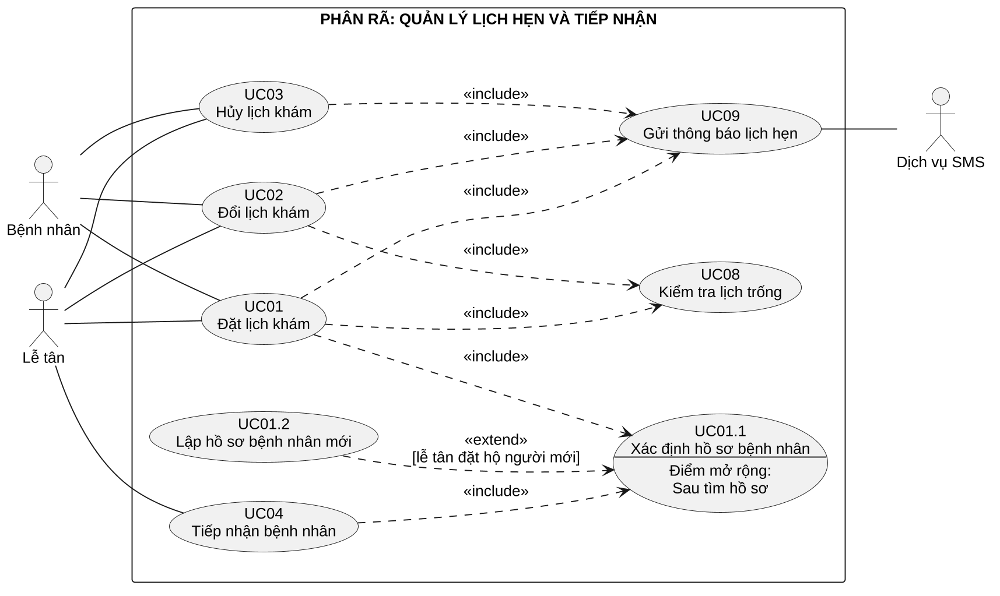
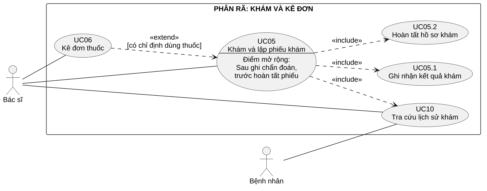
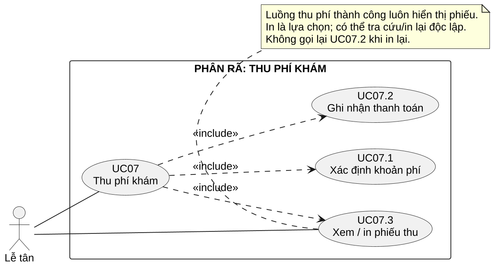

# Phụ lục C. Cập nhật theo góp ý giảng viên

## C.1. Nội dung cập nhật ngày 15/10/2026

**Góp ý được người dùng chuyển lại:** nhóm mới có một sơ đồ Use Case, cần bổ sung sơ đồ phân rã chi tiết. Tài liệu bổ sung ba sơ đồ theo ba nhóm nghiệp vụ: quản lý lịch hẹn/tiếp nhận, khám/kê đơn, thu phí. Sơ đồ tổng thể tại Mục 4.3 vẫn giữ nguyên để thể hiện ranh giới và các mục tiêu chính.

**Quy ước:** Mã UC01–UC10 giữ nguyên; UCxx.y là hành vi con của nghiệp vụ đã có. Bảy Use Case con không phải bảy yêu cầu mới ngoài phạm vi. Phần chính trình bày 10 Use Case mức tổng thể; bản cập nhật có thêm 7 Use Case con ở ba góc nhìn phân rã. Một Use Case xuất hiện ở nhiều hình vẫn là cùng một Use Case, không được đếm lại thành chức năng khác.

| Use Case con | Nguồn trong đặc tả gốc | Yêu cầu liên quan |
| --- | --- | --- |
| UC01.1 — Xác định hồ sơ bệnh nhân | UC01 bước 2; UC04 bước 1–3 | FR05, BR03 |
| UC01.2 — Lập hồ sơ bệnh nhân mới | UC01 bước 2 và bước 6, nhánh lễ tân đặt hộ người mới | FR05, UC01 E1 |
| UC05.1 — Ghi nhận kết quả khám | UC05 bước 4, nhánh A3 | FR08, BR05 |
| UC05.2 — Hoàn tất hồ sơ khám | UC05 bước 6–7, nhánh A5/E1 | FR08–FR09, BR05 |
| UC07.1 — Xác định khoản phí | UC07 bước 1–2; UC04 bước 5–6 | FR10, BR06 |
| UC07.2 — Ghi nhận thanh toán | UC07 bước 3–6 | FR10, NFR04 |
| UC07.3 — Xem/in phiếu thu | UC07 bước 7, nhánh A2/E2/E3 | FR11, BR06 |

**Giải thích include/extend khi phân rã:** Include trỏ từ Use Case sử dụng sang hành vi dùng chung hoặc bắt buộc trong luồng thành công. Extend trỏ từ hành vi bổ sung về Use Case cơ sở, kèm điều kiện và điểm mở rộng. UC01.2 chỉ xảy ra khi lễ tân đặt hộ người mới; UC06 chỉ xảy ra khi bác sĩ có chỉ định thuốc. Không dùng include để nối toàn bộ tiếp nhận → khám → thanh toán thành một Use Case lớn.

**Điều kiện giao dịch không đổi:** UC01.2 chuẩn bị hồ sơ mới; hồ sơ chỉ được lưu cùng lịch hẹn ở bước 6 của UC01, không tạo hồ sơ tồn dư khi người dùng hủy đặt. UC05.2 hoàn tất phiếu, đơn nếu có và lượt trong một lần lưu. UC07.3 chỉ đọc/in chứng từ đã lưu, không ghi một khoản thu mới.

Các phần từ C.2 đến C.6 dưới đây là bổ sung chi tiết; danh sách Actor, phạm vi, FR/NFR, BR và năm đặc tả chính của bản gốc tiếp tục được áp dụng. Bìa kế thừa thông tin đã điền trong tệp Word giai đoạn 1 hiện có; các ô thành viên còn trống cần được hoàn thiện.

\landscape

## C.2. Phân rã quản lý lịch hẹn và tiếp nhận

UC01 và UC04 đều cần xác định đúng hồ sơ bệnh nhân. UC01.2 mở rộng UC01.1 tại điểm “Sau tìm hồ sơ”, chỉ trong ngữ cảnh lễ tân đang đặt hộ người mới. UC04 có tiền điều kiện đã có lịch/hồ sơ nên không dùng nhánh tạo mới tại quầy tiếp nhận; bệnh nhân chưa có lịch phải thực hiện UC01 trước theo UC04 A1.

\landscape

## C.3. Phân rã khám và kê đơn

Luồng UC05 thành công luôn tra cứu lịch sử, ghi kết quả và hoàn tất hồ sơ. Lưu nháp rồi rời màn hình là nhánh dừng/chưa hoàn thành mục tiêu, nên có thể chưa đến UC05.2. UC06 tiếp tục là extend có điều kiện; không đổi thành include vì có lần khám không cần thuốc. Bệnh nhân chỉ tra cứu kết quả đã hoàn tất của mình theo UC10.

\landscape

## C.4. Phân rã thu phí khám

UC07.1 lấy mức phí đã chốt; UC07.2 ghi một lần thu; UC07.3 hiển thị chứng từ sau khi thu thành công. Trong UC07.3, xem phiếu là bước chính và in là lựa chọn. Association từ Lễ tân đến UC07.3 thể hiện khả năng tra cứu/in lại độc lập, không cần thực hiện lại UC07 hoặc UC07.2.

\page

## C.5. Đặc tả Use Case con — hồ sơ và khám

**UC01.1 — Xác định hồ sơ bệnh nhân**

**Actor:** Bệnh nhân hoặc Lễ tân qua UC01; Lễ tân qua UC04. **Tiền điều kiện:** Đã xác thực, có quyền đặt lịch/tiếp nhận. **Luồng chính:** (1) Nhận mã hoặc thông tin nhận diện; tài khoản bệnh nhân dùng hồ sơ của chính mình. (2) Tìm hồ sơ phù hợp. (3) Lễ tân đối chiếu họ tên, ngày sinh, số điện thoại và chọn đúng hồ sơ. **Phụ/ngoại lệ:** Nhiều hồ sơ giống nhau thì xác minh thêm, không tự gộp; không xác định được thì dừng. Người mới trong UC01 có thể chuyển UC01.2. **Hậu điều kiện:** Trả đúng hồ sơ được phép sử dụng; không cập nhật lịch hoặc tạo lượt tại bước này.

**UC01.2 — Lập hồ sơ bệnh nhân mới**

**Actor:** Lễ tân. **Tiền điều kiện:** Đang đặt hộ trong UC01, đã kiểm tra không có hồ sơ phù hợp; mở rộng UC01.1 sau tìm hồ sơ. **Luồng chính:** (1) Nhập họ tên, ngày sinh, số điện thoại. (2) Kiểm tra đầy đủ/hợp lệ, đối chiếu lại tránh tạo nhầm. (3) Xác nhận dữ liệu hồ sơ mới để dùng cho lịch đang đặt. **Phụ/ngoại lệ:** Dữ liệu sai cho sửa; phát hiện hồ sơ cũ thì quay UC01.1; hủy đặt không lưu hồ sơ mới. **Hậu điều kiện:** Có dữ liệu hồ sơ mới chờ lưu; chỉ được cấp/lưu mã bền vững cùng giao dịch UC01 bước 6. Lỗi giao dịch hoàn tác cả hồ sơ mới và lịch.

**UC05.1 — Ghi nhận kết quả khám**

**Actor:** Bác sĩ được phân công. **Tiền điều kiện:** Lượt Đang khám, có phiếu nháp. **Luồng chính:** (1) Nhập triệu chứng, kết quả khám, chẩn đoán và hướng xử trí. (2) Rà soát. (3) Lưu nháp với phiên bản hiện có. **Phụ/ngoại lệ:** Dữ liệu không hợp lệ phải sửa; sai quyền, lượt đã hoàn tất hoặc xung đột phiên bản thì từ chối; lỗi lưu giữ bản đã lưu gần nhất. **Hậu điều kiện:** Phiếu nháp được lưu thành công hoặc giữ nguyên bản cũ; lượt vẫn Đang khám, chưa công bố cho bệnh nhân.

**UC05.2 — Hoàn tất hồ sơ khám**

**Actor:** Bác sĩ được phân công. **Tiền điều kiện:** Lượt Đang khám, có phiếu nháp và đơn nháp nếu có. **Luồng chính:** (1) Rà soát phiếu/đơn. (2) Yêu cầu hoàn tất. (3) Hệ thống kiểm tra quyền, phiên bản, chẩn đoán/hướng xử trí và đơn nếu có. (4) Lưu đồng thời phiếu, đơn và lượt Hoàn tất. **Phụ/ngoại lệ:** Thiếu dữ liệu hoặc xung đột thì giữ nháp; lỗi lưu rollback, không hoàn tất một phần. **Hậu điều kiện:** Hồ sơ hoàn tất được phép xem theo quyền, lượt đủ điều kiện thu phí; nếu thất bại vẫn giữ trạng thái trước đó.

\page

## C.6. Đặc tả Use Case con — thu phí

**UC07.1 — Xác định khoản phí**

**Actor:** Lễ tân. **Tiền điều kiện:** Đã xác thực, có quyền thu phí; có mã lượt cần tra cứu. **Luồng chính:** (1) Tìm và chọn đúng lượt. (2) Hệ thống đối chiếu bệnh nhân, trạng thái, dịch vụ và phí đã chốt khi tiếp nhận. (3) Hiển thị khoản phải thu và trạng thái đã/chưa thu, không trả nội dung bệnh án. **Phụ/ngoại lệ:** Lượt chưa Hoàn tất không được chuyển sang ghi thu; đã thu thì dẫn tới phiếu hiện có; không tìm thấy/sai quyền thì từ chối. **Hậu điều kiện:** Xác định khoản phí để quyết định tiếp tục, chưa tạo khoản thu.

**UC07.2 — Ghi nhận thanh toán**

**Actor:** Lễ tân. **Tiền điều kiện:** Lượt Hoàn tất, phí hợp lệ, chưa có phiếu thu; lễ tân đối chiếu tiền mặt thực nhận. **Luồng chính:** (1) Nhập tiền nhận. (2) Kiểm tra đủ tiền và tính tiền trả lại. (3) Lễ tân xác nhận đã nhận đủ. (4) Hệ thống kiểm tra lại và lưu đúng một phiếu thu gắn lượt, thời điểm và người thu. **Phụ/ngoại lệ:** Thiếu tiền không ghi thu một phần; yêu cầu lặp trả phiếu đã có; lỗi/mất phản hồi tra lại theo mã lượt trước khi thử lại, không yêu cầu bệnh nhân trả thêm. **Hậu điều kiện:** Có một phiếu hợp lệ, lượt Đã thu; hoặc không có thay đổi khi giao dịch thất bại. Tiền đã trao thực tế được xử lý theo UC07 E1–E2.

**UC07.3 — Xem/in phiếu thu**

**Actor:** Lễ tân. **Tiền điều kiện:** Đã xác thực và có quyền; phiếu thu hợp lệ đã được lưu. **Luồng chính:** (1) Hệ thống lấy phiếu theo mã lượt hoặc mã phiếu. (2) Hiển thị mã, bệnh nhân, dịch vụ, số tiền, tiền nhận, tiền trả lại, thời điểm và người thu. (3) Nếu cần, lễ tân chọn in. **Phụ/ngoại lệ:** Không tìm thấy phiếu thì yêu cầu đối soát, không tạo phiếu mới; lỗi in cho in lại cùng mã; sai quyền từ chối. **Hậu điều kiện:** Xem/in chứng từ hiện có; trạng thái thanh toán và số khoản thu không đổi.

**Cập nhật nhật ký AI:** Ngày 15/10/2026, người dùng chuyển góp ý cần thêm sơ đồ phân rã. AI hỗ trợ dựng ba hình C1–C3 và bảy đặc tả con từ các bước hiện có, rồi đối chiếu với Class/Sequence ở giai đoạn 2. Nhóm cần tiếp tục đọc và ghi nhận xét đúng/sai cụ thể; chưa có xác nhận rằng giảng viên đã duyệt bản cập nhật.
