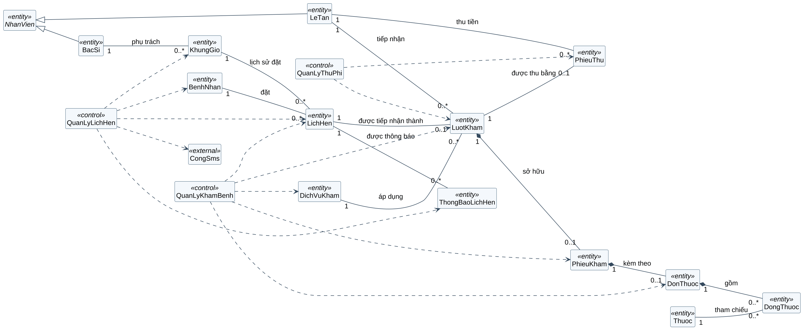
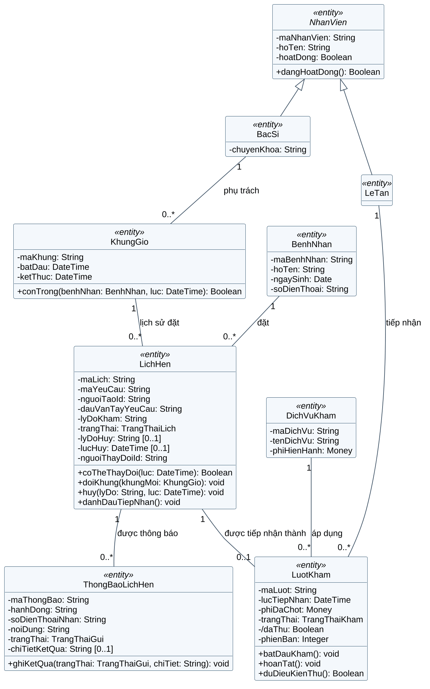
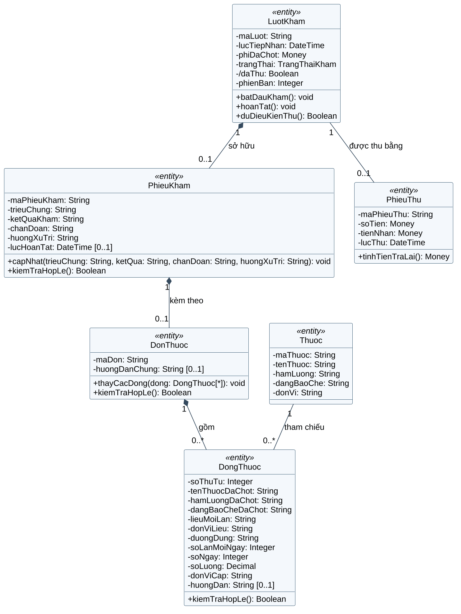
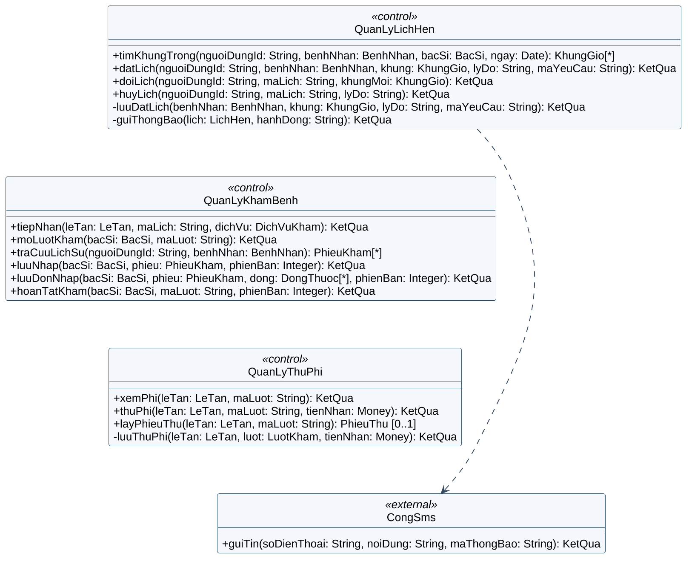
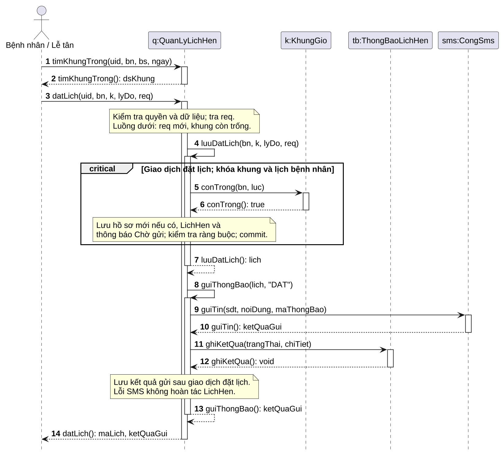
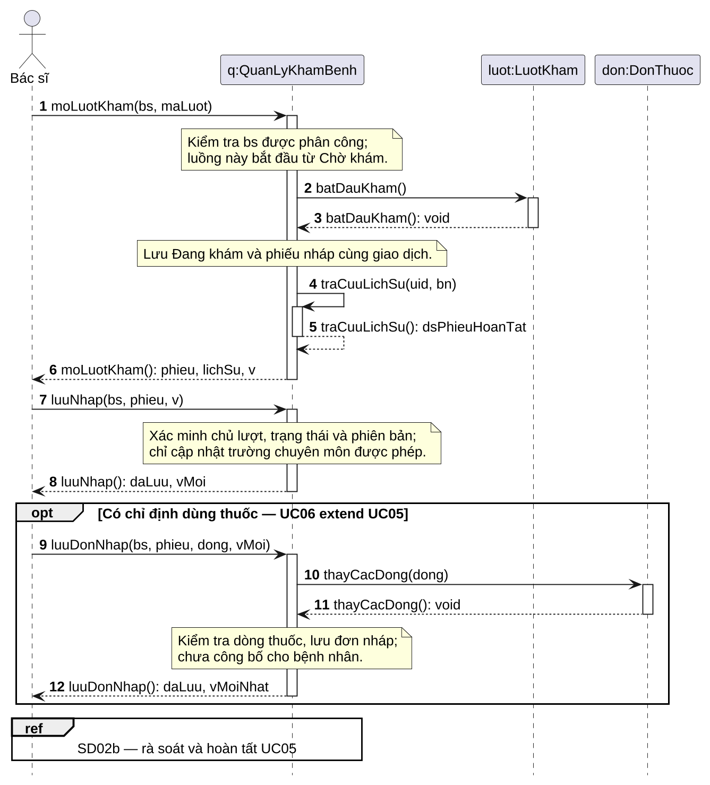
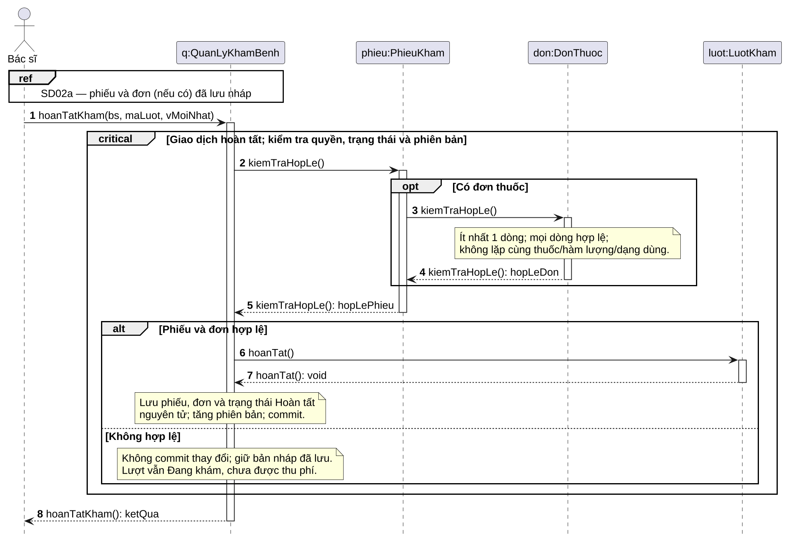
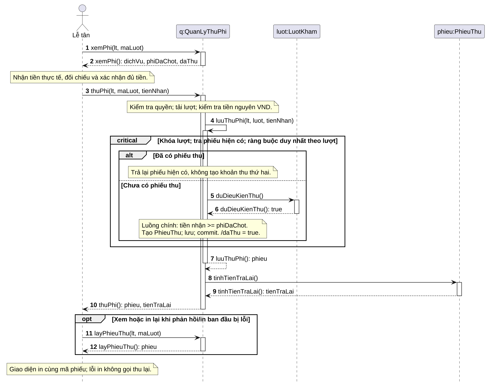
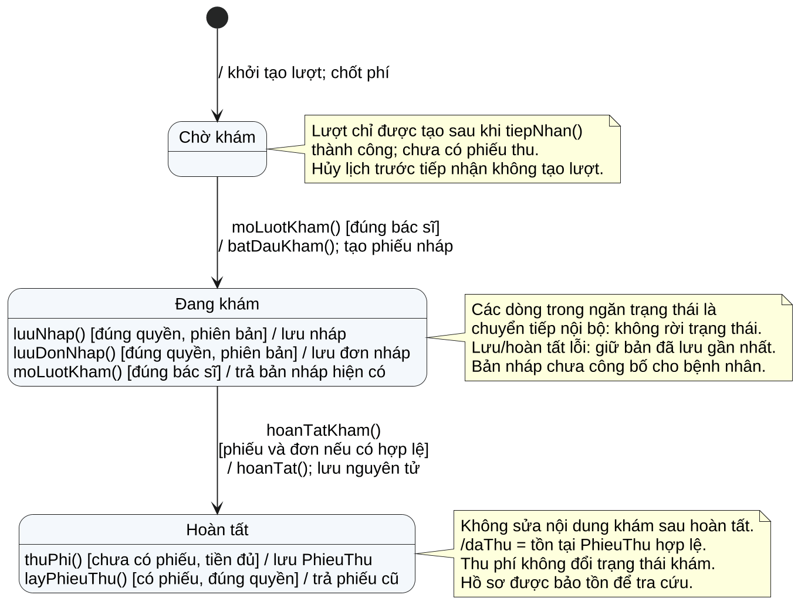

# 1. Cơ sở và phạm vi giai đoạn 2

## 1.1. Yêu cầu phải đáp ứng

Báo cáo thực hiện Mục 5 của đề bài “Phân tích & Thiết kế một hệ thống phần mềm theo hướng đối tượng”: sơ đồ lớp có ít nhất 6 lớp và các quan hệ phù hợp; thuyết minh SRP/OCP; ít nhất 2 sơ đồ tuần tự khớp phương thức của lớp; một sơ đồ Activity hoặc State; ghi chú các điều chỉnh thiết kế phát hiện khi dựng luồng.

Đề tài tiếp tục là **Thiết kế hệ thống quản lý phòng khám tư nhân**. Phạm vi giữ nguyên: một cơ sở khám ngoại trú, đặt lịch, tiếp nhận, khám/kê đơn, thu phí khám bằng tiền mặt và thông báo SMS. Không bổ sung bán thuốc, bảo hiểm hoặc thanh toán trực tuyến.

## 1.2. Tiếp thu góp ý giai đoạn 1

Ngày 15/10/2026, người dùng chuyển góp ý của giảng viên: nhóm mới có một sơ đồ Use Case, cần thêm sơ đồ phân rã chi tiết. Bản cập nhật giai đoạn 1 được nộp kèm, bổ sung **ba sơ đồ phân rã và bảy Use Case con**:

- Lịch hẹn/tiếp nhận: UC01.1 Xác định hồ sơ bệnh nhân; UC01.2 Lập hồ sơ bệnh nhân mới.
- Khám/kê đơn: UC05.1 Ghi nhận kết quả khám; UC05.2 Hoàn tất hồ sơ khám.
- Thu phí: UC07.1 Xác định khoản phí; UC07.2 Ghi nhận thanh toán; UC07.3 Xem/in phiếu thu.

Mười Use Case ở mức tổng thể vẫn giữ mã UC01–UC10. Các Use Case con chi tiết hóa các bước đã có, không tạo một chức năng nghiệp vụ mới ngoài Brief. Phụ lục C của bản giai đoạn 1 cập nhật có đặc tả rút gọn đủ sáu phần và bảng nối với luồng cũ. Đây là cơ sở để rút lớp và phương thức trong báo cáo này.

## 1.3. Quy ước thiết kế

Tên lớp dùng PascalCase không dấu; tên phương thức dùng lowerCamelCase. Dấu “−” là private, “+” là public. “/daThu” là thuộc tính suy dẫn, không phải cột trạng thái thứ hai phải cập nhật độc lập.

Mô hình gồm **14 lớp thực thể, 3 lớp điều phối và 1 lớp mô tả dịch vụ ngoài**. Các lớp điều phối được rút từ trách nhiệm của hệ thống trong Use Case; không coi chúng là dữ liệu bệnh án. CongSms biểu diễn hợp đồng với Secondary Actor, không thuộc phần mềm phòng khám.

Ba tương tác được chọn: SD01 đặt lịch; SD02 khám/kê đơn (hai hình liên tiếp); SD03 thu phí. Máy trạng thái SM01 mô tả LuotKham. Giao diện và cơ chế lưu trữ được lược khỏi lifeline để tập trung vào các đối tượng nghiệp vụ; ranh giới giao dịch, kiểm tra quyền và việc lưu dữ liệu vẫn được mô tả rõ.

Bìa kế thừa thông tin giảng viên, lớp, nhóm và thành viên đã điền trong tệp Word giai đoạn 1 hiện có; các ô thành viên còn trống cần được hoàn thiện. Tất cả trang dùng A4; một số sơ đồ rộng dùng A4 ngang; số trang ở giữa đầu trang, footer trống.

\page

# 2. Rút lớp từ Use Case Specification

## 2.1. Các lớp thực thể

“GĐ1” dưới đây chỉ bản giai đoạn 1 cập nhật. Cột nguồn chỉ đến bước hoặc quy tắc cụ thể, thay vì chỉ nêu tên đề tài.

| Lớp | Danh từ / căn cứ GĐ1 | Trách nhiệm chính |
| --- | --- | --- |
| NhanVien | “Bác sĩ”, “Lễ tân”; UC04, UC05, UC07; PB05 | Lớp trừu tượng khái quát mã, họ tên và tình trạng hoạt động của nhân viên. |
| BacSi | UC01 bước 3; UC05 bước 1–2 | Vai trò bác sĩ, chuyên khoa và các khung giờ phụ trách. |
| LeTan | UC04 bước 3–6; UC07 bước 3–6 | Vai trò nhân viên tiếp nhận và người ghi nhận khoản thu. |
| BenhNhan | UC01 bước 2; UC01.1–UC01.2 | Hồ sơ nhận diện: mã, họ tên, ngày sinh, số điện thoại. |
| KhungGio | UC01 bước 3, 6; UC08 | Khoảng thời gian thuộc một bác sĩ; kiểm tra khả dụng và xung đột lịch. |
| LichHen | UC01 bước 6; UC02–UC03; BR01–BR04 | Ghi nhận lịch đặt, đổi/hủy và việc đã tiếp nhận. |
| LuotKham | UC04 bước 6; UC05 bước 2, 7 | Theo dõi Chờ khám → Đang khám → Hoàn tất và phí đã chốt. |
| DichVuKham | UC04 bước 3–5; BR06 | Danh mục dịch vụ, tên và mức phí hiện hành khi tiếp nhận. |
| PhieuKham | UC05 bước 4–7; UC05.1–UC05.2 | Chứa kết quả chuyên môn; kiểm tra đủ điều kiện hoàn tất. |
| DonThuoc | UC06 bước 1, 5–7; BR05 | Tập hợp dòng thuốc cho một phiếu; kiểm tra đơn hợp lệ. |
| DongThuoc | UC06 bước 2–5; FR09 | Một dòng chỉ định: thuốc, hàm lượng, liều, đường dùng, thời gian, số lượng. |
| Thuoc | UC06 bước 2; danh mục chuẩn bị sẵn | Thông tin thuốc để chọn và tham chiếu; không quản lý tồn kho. |
| PhieuThu | UC07 bước 6–7; UC07.2–UC07.3 | Chứng từ một lần thu, người thu, tiền nhận và tiền trả lại. |
| ThongBaoLichHen | UC01 bước 7; UC09; BR07 | Lưu nội dung, người nhận và kết quả yêu cầu gửi SMS cho lịch hẹn. |

**Cách rút lớp:** “Hồ sơ bệnh nhân” không tách thành một lớp vỏ chỉ chứa mã. BenhNhan giữ thông tin nhận diện; lịch sử là tập các PhieuKham hoàn tất truy theo BenhNhan → LichHen → LuotKham. NhanVien là sự khái quát có chủ đích từ hai vai trò thực tế, không phải một Actor mới.

\page

## 2.2. Lớp điều phối, dịch vụ ngoài và kiểu dữ liệu

| Lớp | Nguồn trách nhiệm | Ranh giới trách nhiệm |
| --- | --- | --- |
| QuanLyLichHen | UC01 bước 3, 6–8; UC02–03; UC08–09 | Kiểm tra quyền đặt/đổi/hủy, phối hợp kiểm tra lịch, lưu giao dịch và gọi gửi SMS sau khi lưu. |
| QuanLyKhamBenh | UC04 bước 4–7; UC05–06; UC10 | Tiếp nhận, mở lượt, lấy lịch sử, lưu nháp và hoàn tất hồ sơ trong đúng giao dịch. |
| QuanLyThuPhi | UC07 bước 2, 4, 6–7 | Kiểm tra quyền và phí đã chốt, ghi thu duy nhất theo lượt, tra cứu phiếu để in lại. |
| CongSms | Secondary Actor “Dịch vụ SMS”; UC09 | Hợp đồng guiTin() của dịch vụ ngoài; trả kết quả chấp nhận, lỗi hoặc chưa xác định. |

Các lớp control là sự phân bổ trách nhiệm thiết kế từ các động từ “hệ thống kiểm tra/lưu/gửi/hiển thị” trong đặc tả. Không tạo lớp điều phối chung quản lý mọi nghiệp vụ. Tài khoản đã được cấp trước và xác thực là tiền điều kiện; cơ chế đăng nhập không được mở rộng thành một phân hệ mới.

| Kiểu / ký hiệu | Ý nghĩa |
| --- | --- |
| String, Boolean, Integer, Decimal | Các kiểu giá trị cơ bản; dữ liệu nhập phải được kiểm tra trước khi sử dụng. |
| Date, DateTime | Ngày hoặc thời điểm; hiển thị theo giờ Việt Nam, so sánh trên cùng chuẩn thời gian. |
| Money | Số nguyên VND không âm, dùng kiểu số đủ lớn; không dùng số thực nhị phân để tính tiền. |
| TrangThaiLich | DA_XAC_NHAN, DA_TIEP_NHAN, DA_HUY. “Quá giờ” là điều kiện hiển thị, không thêm trạng thái. |
| TrangThaiKham | CHO_KHAM, DANG_KHAM, HOAN_TAT. |
| TrangThaiGui | CHO_GUI, DA_CHUYEN_NHA_CUNG_CAP, GUI_LOI, CHUA_XAC_DINH. |
| KetQua | Bản ghi kết quả: thành công/lỗi, mã lỗi và dữ liệu trả về theo từng operation; không phải lớp thực thể lưu trữ. |
| T[*], T [0..1] | Danh sách giá trị kiểu T; hoặc một giá trị T có thể vắng mặt. |

Tham số bs, lt và uid trong các sơ đồ là danh tính đã được xác thực, được máy chủ đối chiếu lại; không tin đối tượng hoặc vai trò do giao diện tự gửi. Các tham số entity trong sơ đồ biểu diễn dữ liệu nghiệp vụ; triển khai thực tế nhận mã/dữ liệu được phép và tải lại bản ghi có thẩm quyền trước khi ghi.

\landscape

## 2.3. Class Diagram — toàn bộ quan hệ

**Hình 1.** Sơ đồ tổng quan ẩn ngăn thuộc tính/phương thức để đọc các quan hệ. Ba hình chi tiết tiếp theo là các góc nhìn của cùng mô hình, cùng lấy định nghĩa từ mo_hinh_lop.iuml. Các đường nét đứt từ control là dependency; bội số chỉ đặt trên association/composition, không đặt trên dependency.

Mũi tên tam giác rỗng trỏ về NhanVien biểu diễn kế thừa. Hình thoi đặc đặt ở phía chủ sở hữu biểu diễn composition. Các ràng buộc “một lịch hiệu lực mỗi khung”, “một phiếu thu mỗi lượt” được giải thích tại Mục 2.7; số lượng lịch sử có thể lớn hơn số chỗ đang còn hiệu lực.

\page

## 2.4. Chi tiết lớp — lịch hẹn và tiếp nhận

**Hình 2.** maYeuCau chống gửi lặp thao tác đặt lịch. phiDaChot lưu mức phí tại thời điểm tiếp nhận. BacSi của lượt khám được suy ra qua LichHen → KhungGio; sau tiếp nhận không được đổi lịch nên liên kết này không thay đổi.

\page

## 2.5. Chi tiết lớp — khám, đơn thuốc và phiếu thu

**Hình 3.** Dòng thuốc lưu bản chụp tên, hàm lượng và dạng bào chế tại lúc kê, để lịch sử không đổi khi danh mục được cập nhật. Bội số 0..* cho phép đơn đang biên tập; đơn được lưu hợp lệ/hoàn tất phải có ít nhất một dòng theo BR05 và UC06.

\page

## 2.6. Chi tiết lớp — các operation điều phối

**Hình 4.** Operation public là điểm vào của nghiệp vụ sau xác thực. luuDatLich(), guiThongBao() và luuThuPhi() là private, chỉ được gọi nội bộ lớp sở hữu. CongSms là hệ thống bên ngoài được mô hình hóa với operation để truy vết lời gọi.

Các constructor và thao tác truy vấn cơ sở dữ liệu thuần kỹ thuật không được vẽ thành thông điệp riêng. Việc tạo/lưu entity nằm trong operation điều phối và được ghi rõ bằng note trong sơ đồ tuần tự. Không có lời gọi “save()” tới một lớp cơ sở dữ liệu không được khai báo.

\page

## 2.7. Giải thích quan hệ và ràng buộc

**Association:** BenhNhan–LichHen, BacSi–KhungGio, LichHen–LuotKham, DichVuKham–LuotKham, Thuoc–DongThuoc và LuotKham–PhieuThu là các liên kết nghiệp vụ. Một lượt thuộc đúng một lịch; một lịch có không hoặc một lượt. Phiếu thu là chứng từ cần bảo tồn, nên không dùng composition để hàm ý xóa theo lượt khám.

**Composition:** LuotKham sở hữu tối đa một PhieuKham; PhieuKham sở hữu tối đa một DonThuoc; DonThuoc sở hữu các DongThuoc. Mỗi phần tử con chỉ thuộc một chủ sở hữu, không được chia sẻ giữa các lượt/đơn. Chưa bắt đầu khám có thể chưa có phiếu; không chỉ định thuốc thì không có đơn. Đây là quyền sở hữu đối tượng, không phải chỉ dẫn bật xóa dây chuyền trong cơ sở dữ liệu; phạm vi không có chức năng xóa bệnh án đã hoàn tất.

**Inheritance:** BacSi và LeTan “là một” NhanVien, dùng chung mã nhân viên, họ tên và kiểm tra hoạt động. Hai lớp chuyên biệt vẫn giữ vai trò riêng. Đây là khái quát hóa vai trò, không khẳng định một người không thể đảm nhiệm nhiều vai trò; quyền được kiểm tra ở điểm vào nghiệp vụ. Không ép BenhNhan kế thừa NhanVien và không dùng kế thừa giữa phiếu khám với đơn thuốc.

| Bất biến | Ý nghĩa / nơi bảo đảm |
| --- | --- |
| I01 — Một chỗ hiệu lực | KhungGio có nhiều LichHen lịch sử, nhưng tại một thời điểm chỉ có tối đa một lịch chưa hủy. Bác sĩ không có khung chồng lấn; lịch làm việc là dữ liệu chuẩn bị trước. |
| I02 — Không trùng bệnh nhân | Khoảng [batDau, ketThuc) của hai lịch hiệu lực cùng bệnh nhân không giao nhau; conTrong() kiểm tra, giao dịch khóa bệnh nhân khi ghi để ngăn tranh chấp. |
| I03 — Đúng một lần tiếp nhận | LichHen–LuotKham là 1–0..1; lưu trạng thái Đã tiếp nhận và lượt mới trong cùng giao dịch, có ràng buộc duy nhất theo mã lịch. |
| I04 — Hoàn tất đồng bộ | Lượt Hoàn tất phải có phiếu đủ nội dung; có đơn thì đơn và mọi dòng phải hợp lệ. Lưu phiếu/đơn/trạng thái nguyên tử, kiểm tra phienBan. |
| I05 — Thu đúng một lần | Mã lượt trên PhieuThu là duy nhất; soTien = phiDaChot; tienNhan ≥ soTien; /daThu bằng việc tồn tại phiếu hợp lệ. |
| I06 — Giữ đúng bệnh án | Bệnh nhân và bác sĩ của phiếu suy từ lượt/lịch, không nhập một mã bệnh nhân khác vào phiếu. Hồ sơ hoàn tất không sửa trong phạm vi. |

NFR07 yêu cầu nhật ký thao tác; các operation ghi người thực hiện, thời điểm, mã đối tượng và kết quả qua cơ chế nhật ký hạ tầng. Không ghi nội dung chẩn đoán hoặc đơn thuốc vào log vận hành.

\page

# 3. Thuyết minh vận dụng SOLID

**SRP — Một lý do thay đổi.** PhieuKham dễ trở thành lớp làm tất cả nếu vừa ghi chẩn đoán, kê thuốc, tính phí, gửi SMS và in phiếu. Thiết kế giới hạn lớp này ở nội dung khám và kiểm tra điều kiện hoàn tất. DonThuoc/DongThuoc giữ quy tắc về đơn; PhieuThu giữ các số tiền và tính tiền trả lại; QuanLyThuPhi điều phối ghi thu. QuanLyLichHen chịu trách nhiệm giao dịch lịch và yêu cầu gửi thông báo, còn CongSms là hợp đồng với bên cung cấp SMS. Nhờ vậy, thay mẫu phiếu in không sửa PhieuKham, thay cách ghi nhận thu phí không sửa DonThuoc. Giao diện chịu trách nhiệm trình bày/in dữ liệu đã trả về; entity không tự in hoặc truy cập thiết bị.

**OCP — Tình huống mở rộng có căn cứ.** Giai đoạn 1 hiện chỉ yêu cầu SMS. Nếu sau này phòng khám bổ sung email hoặc đổi nhà cung cấp, việc thêm nhiều nhánh điều kiện trực tiếp vào QuanLyLichHen sẽ khiến logic đã ổn định phải sửa theo từng kênh. Có thể tách hợp đồng KenhThongBao với operation gui(), rồi để từng kênh hiện thực hợp đồng; phần điều phối đặt/đổi/hủy chỉ sử dụng hợp đồng đó. Đây là điểm mở rộng dự kiến xuất phát từ UC09, không phải chức năng đã được yêu cầu trong bản hiện tại. Giai đoạn 2 giữ một CongSms cụ thể; chưa thêm các lớp email hoặc áp dụng Design Pattern chỉ để đủ tên. Giai đoạn 3 sẽ đánh giá việc chọn pattern theo vấn đề thực sự và yêu cầu của đề bài.

**LSP trong phần kế thừa hiện có.** BacSi và LeTan kế thừa hợp đồng dangHoatDong() của NhanVien; lớp con không thay nghĩa của mã nhân viên hoặc kết quả kiểm tra. Quyền khám và thu phí không được gộp thành operation chung buộc một lớp con phải từ chối hoặc để trống.

Phần SRP/OCP trên là thuyết minh trọng tâm theo Mục 5.1.2 của đề bài; mô hình không thêm interface/factory cho mọi lớp. Chỉ có ba control tương ứng ba nhóm nghiệp vụ đang tồn tại, và mỗi thay đổi đều có nguồn từ đặc tả.

\page

# 4. Sequence Diagram

## 4.1. SD01 — Đặt lịch khám (UC01)

**Phạm vi hình:** Bệnh nhân đã được xác định, Actor đã chọn hoặc nhập thông tin để xác nhận. Nhánh chính dùng mã yêu cầu mới, khung còn trống. Nếu lễ tân lập hồ sơ mới theo UC01.2, hồ sơ chỉ được lưu cùng giao dịch đặt lịch. uid: người thao tác; bn: bệnh nhân; bs: bác sĩ; k: khung; req: mã yêu cầu chống gửi lặp; luc: thời điểm kiểm tra.

\page

## 4.2. Đối chiếu SD01 và các nhánh ngoại lệ

| Nguồn GĐ1 | Operation trong SD01 | Kết quả / trách nhiệm |
| --- | --- | --- |
| UC01 bước 3; UC08 | QuanLyLichHen.timKhungTrong() | Kiểm tra quyền, trả các khung khả dụng để chọn. |
| UC01 bước 5–6 | QuanLyLichHen.datLich() | Kiểm tra chủ lịch/lễ tân, dữ liệu và mã yêu cầu; điều phối lưu. |
| UC01 bước 6; NFR04 | luuDatLich(); KhungGio.conTrong() | Giao dịch khóa khung và bệnh nhân; kiểm tra lại chỗ trống trước khi ghi. |
| UC01 bước 7; UC09 | guiThongBao(); CongSms.guiTin() | Chỉ gọi bên ngoài sau commit; thời gian chờ tối đa 5 giây. |
| UC01 E2; BR07 | ThongBaoLichHen.ghiKetQua() | Ghi chấp nhận/lỗi/chưa xác định; không hoàn tác lịch đã lưu. |
| UC01 bước 8 | Giá trị trả về của datLich() | Mã lịch và kết quả gửi; không khẳng định SMS đã đến điện thoại. |

**Hợp đồng giao dịch đặt lịch.** Mã yêu cầu duy nhất theo nguoiTaoId được tạo một lần cho một lần xác nhận; dauVanTayYeuCau lưu dấu vân tay của dữ liệu đặt ban đầu đã chuẩn hóa, giữ nguyên khi lịch được đổi/hủy. Nếu đã có kết quả cùng mã và cùng dữ liệu, trả lại lịch cũ, không tạo lịch hoặc gửi SMS lần hai; dùng lại mã với dữ liệu khác bị từ chối. luuDatLich() khóa bản ghi khung và bệnh nhân theo thứ tự thống nhất, kiểm tra chỗ và khoảng thời gian, tạo hồ sơ nếu là người mới, lưu lịch cùng bản ghi thông báo CHO_GUI rồi commit. Ràng buộc duy nhất ngăn hai lịch hiệu lực chiếm cùng khung. Khóa bệnh nhân ngăn hai yêu cầu đặt vào hai khung khác nhau nhưng trùng thời gian.

| Trường hợp | Xử lý thiết kế |
| --- | --- |
| Chỗ bị người khác chiếm sau khi hiển thị | conTrong() trả false trong giao dịch; rollback, trả mã HET_CHO để chọn lại; không gửi SMS. |
| Hai yêu cầu cùng mã req | Chỉ một giao dịch ghi; yêu cầu còn lại đọc kết quả đã commit. Khi kết quả chưa rõ, trả trạng thái cần tra lại, không tạo mã mới tự động. |
| Lỗi lưu hồ sơ/lịch/thông báo ban đầu | Rollback toàn bộ, không giữ chỗ và không để lại hồ sơ mới được tạo nửa chừng. |
| Nhà cung cấp SMS lỗi/quá hạn | Lịch vẫn Đã xác nhận; lưu GUI_LOI hoặc CHUA_XAC_DINH và báo lễ tân. |
| Lỗi sau commit trước khi lưu kết quả SMS | Thông báo còn CHO_GUI/chưa xác định; lễ tân cần đối soát. Không tự gửi lặp nếu chưa biết bên ngoài đã nhận hay chưa. |

Đổi lịch dùng cùng nguyên tắc: khóa lịch cũ, khung mới và bệnh nhân; bỏ qua chính lịch đang đổi khi kiểm tra xung đột; giữ mã lịch, thay khung trong một giao dịch. Hủy chỉ đổi trạng thái và nhả chỗ theo BR02, không xóa lịch sử.

\page

## 4.3. SD02a — Mở lượt và lưu nháp (UC05/UC06)

**Hình 6.** Khối opt tương ứng UC06 extend UC05: không có chỉ định thì bỏ qua toàn bộ phần kê đơn. Lịch sử rỗng vẫn là kết quả hợp lệ của UC10. v là phiên bản của lượt; mỗi lần lưu thành công trả phiên bản mới để dùng cho lần ghi tiếp theo. Hình 7 tiếp nối tương tác này.

\landscape

## 4.4. SD02b — Hoàn tất hồ sơ khám

**Hình 7.** Kiểm tra quyền/trạng thái/phiên bản xảy ra trước thay đổi dữ liệu trong khối critical. PhieuKham.kiemTraHopLe() kiểm tra cả đơn nếu có; DonThuoc.kiemTraHopLe() kiểm tra mọi dòng. Chỉ nhánh hợp lệ mới gọi LuotKham.hoanTat() và commit. Return message ghi tên operation và dữ liệu trả về; không phải một operation mới gọi ngược về Actor.

\page

## 4.5. Đối chiếu SD02 và tính nhất quán hồ sơ

| Nguồn GĐ1 | Lớp / operation | Diễn giải |
| --- | --- | --- |
| UC05 bước 1–2 | QuanLyKhamBenh.moLuotKham(); LuotKham.batDauKham() | Đúng bác sĩ mới mở lượt; Chờ khám chuyển thành Đang khám, phiếu nháp được tạo cùng giao dịch. |
| UC05 bước 3; UC10 | QuanLyKhamBenh.traCuuLichSu() | Chỉ trả phiếu/đơn hoàn tất đúng quyền; không có dữ liệu trả danh sách rỗng. |
| UC05 bước 4; UC05.1 | QuanLyKhamBenh.luuNhap(); PhieuKham.capNhat() | Lưu các trường chuyên môn được phép; thiếu chẩn đoán có thể giữ nháp nhưng không hoàn tất. |
| UC06 bước 2–6 | QuanLyKhamBenh.luuDonNhap(); DonThuoc.thayCacDong() | Thay tập dòng theo bản gửi đã kiểm tra; không cộng dồn khi gửi lại cùng nội dung. |
| UC05 bước 6–7; UC05.2 | hoanTatKham(); PhieuKham.kiemTraHopLe(); DonThuoc.kiemTraHopLe(); LuotKham.hoanTat() | Kiểm tra đầy đủ rồi hoàn tất phiếu, đơn và lượt cùng giao dịch. |

**Phân biệt nháp và hoàn tất.** PhieuKham.lucHoanTat rỗng khi nháp; thời điểm được ghi khi giao dịch hoàn tất thành công. DonThuoc không giữ thêm cờ “đã phát hành” độc lập; trạng thái công bố suy từ phiếu/lượt. Trước khi công bố, bác sĩ được sửa/xóa dòng; nếu bỏ tất cả thuốc, luuDonNhap() với danh sách rỗng và xác nhận của bác sĩ sẽ bỏ đơn nháp khỏi phiếu, không lưu một đơn rỗng hợp lệ.

**Chống ghi đè.** LuotKham.phienBan tăng sau mỗi lần lưu nháp, thay đơn hoặc hoàn tất. Operation chỉ ghi khi phiên bản nhận được bằng phiên bản đã tải trong giao dịch. Nếu hai phiên làm việc cùng sửa, lần ghi sau bị báo xung đột, phải tải lại; không tự ghi đè kết quả phiên khác.

**Các nhánh lỗi.** Sai bác sĩ bị từ chối trước khi trả dữ liệu chuyên môn. Lượt đã Hoàn tất không được sửa. Đơn thiếu dòng, số lượng không dương hoặc phiếu thiếu chẩn đoán/hướng xử trí bị giữ ở Đang khám. Lỗi lưu phải rollback, giữ bản đã lưu gần nhất. Mất phản hồi khi hoàn tất thì đọc lại lượt: nếu đã Hoàn tất, trả kết quả hiện có; không tạo phiếu mới.

**Bảo vệ lịch sử.** DongThuoc tham chiếu Thuoc nhưng lưu thêm bản chụp tên/hàm lượng/dạng dùng; thay danh mục không sửa đơn đã lưu. Phiếu của bệnh nhân được xác định từ chuỗi liên kết của lượt khám. Lễ tân chỉ nhận thông tin định danh, dịch vụ, trạng thái và phí; không nhận payload chuyên môn khi thu phí.

\landscape

## 4.6. SD03 — Thu phí khám (UC07)

**Hình 8.** Khối alt ưu tiên trả phiếu đã có trước khi tạo mới. Nhánh chưa thu minh họa trường hợp lượt Hoàn tất và nhận đủ tiền. Các điều kiện không đạt được nêu ở trang tiếp theo. Sau commit, /daThu được suy ra từ phiếu; không có lần cập nhật cờ thanh toán riêng có thể bị thất lạc.

\page

## 4.7. Đối chiếu SD03 và xử lý tiền

| Nguồn GĐ1 | Operation | Kết quả |
| --- | --- | --- |
| UC07 bước 1–2; UC07.1 | QuanLyThuPhi.xemPhi() | Trả dịch vụ, mức phí đã chốt và trạng thái; không trả bệnh án. |
| UC07 bước 3–6; UC07.2 | thuPhi(); luuThuPhi(); LuotKham.duDieuKienThu() | Kiểm tra vai trò, tiền và trạng thái; ghi một phiếu duy nhất theo lượt. |
| UC07 bước 4 | PhieuThu.tinhTienTraLai() | tienNhan − soTien, không âm. |
| UC07 bước 7; UC07.3; E3 | QuanLyThuPhi.layPhieuThu() | Lấy đúng phiếu đã lưu; in lại không tạo khoản thu. |

**Giao dịch:** luuThuPhi() khóa lượt khám, tìm phiếu hiện có và kiểm tra lượt Hoàn tất. Nếu chưa có phiếu, tiền nhận phải là số nguyên VND và ít nhất bằng phiDaChot. Lưu PhieuThu với số tiền bằng phiDaChot, tiền nhận thực tế, thời điểm và lễ tân; ràng buộc duy nhất theo mã lượt là lớp bảo vệ cuối. Nếu đã có phiếu, trả lại phiếu đó; giá trị tiền nhận gửi lại không thay phiếu cũ.

**Không lệ thuộc bảng giá mới:** phiDaChot đã được sao chép từ DichVuKham.phiHienHanh khi UC04 tiếp nhận. Đổi bảng giá sau đó không làm thay số phải thu của lượt đang xử lý. Khoản thu không bao gồm tiền thuốc trong phạm vi đề tài.

| Tình huống | Phản hồi và hậu điều kiện |
| --- | --- |
| Chưa khám xong | Từ chối thu, không tạo phiếu. |
| Tiền âm, có phần lẻ VND hoặc nhỏ hơn phí | Báo lỗi/thiếu tiền; giữ Chưa thu, không thu một phần. |
| Hai lễ tân cùng xác nhận | Khóa lượt và ràng buộc duy nhất bảo đảm một phiếu; yêu cầu sau nhận phiếu hiện có. |
| Lỗi ghi trước commit | Không có phiếu hợp lệ; rollback. Lễ tân đối chiếu khoản tiền đã cầm, thử lại hoặc trả lại theo UC07 E1–E2. |
| Mất phản hồi sau commit | Tra theo mã lượt bằng layPhieuThu(); không yêu cầu bệnh nhân trả tiền thêm và không tạo mã thu mới. |
| In lỗi | Khoản thu vẫn hợp lệ; dùng cùng mã phiếu để in lại. |

**Ví dụ kiểm tra bằng tay:** Phí đã chốt 150.000 VND, nhận 200.000 VND → tiền trả lại 50.000 VND. Gửi lại yêu cầu vẫn trả một phiếu với cùng mã. Nếu bảng giá chuyển thành 180.000 VND sau tiếp nhận, lượt này vẫn thu 150.000 VND. Đây là ca kiểm tra thiết kế, chưa phải kết quả chạy phần mềm.

\landscape

# 5. State Diagram — vòng đời lượt khám

**Hình 9.** Chọn State Diagram vì LuotKham có vòng đời và điều kiện chuyển trạng thái rõ theo BR04. Sự kiện là operation điều phối; sau dấu “/” là tác động nghiệp vụ. Các dòng trong ngăn trạng thái là chuyển tiếp nội bộ, không đổi trạng thái. Trạng thái thanh toán không thay thế trạng thái khám: lượt đã thu vẫn Hoàn tất. Hủy lịch trước tiếp nhận không tạo lượt nên không có trạng thái “Lượt khám đã hủy” được tự thêm vào mô hình.

\page

## 5.1. Bảng chuyển trạng thái và điều kiện bảo vệ

| Trước → sau | Sự kiện / điều kiện | Tác động và nguồn |
| --- | --- | --- |
| Chưa tồn tại → Chờ khám | tiepNhan() thành công; lịch Đã xác nhận trong ngày, đúng bệnh nhân, có giá hợp lệ | Tạo lượt duy nhất, chốt phí, gắn lịch; UC04 bước 4–6. |
| Chờ khám → Đang khám | moLuotKham(); bác sĩ đúng phân công | batDauKham(), mở phiếu nháp; UC05 bước 2. |
| Đang khám → Đang khám | luuNhap() / luuDonNhap(); đúng quyền, đúng phiên bản | Lưu nháp, tăng phiên bản; UC05 A3, UC06 bước 6. |
| Đang khám → Hoàn tất | hoanTatKham(); đủ chẩn đoán, hướng xử trí; có đơn thì đơn hợp lệ | hoanTat(), lưu đồng bộ; UC05 bước 7. |
| Hoàn tất → Hoàn tất | thuPhi(); chưa có phiếu, nhận đủ tiền | Lưu phiếu, /daThu = true; UC07 bước 6. |
| Hoàn tất → Hoàn tất | layPhieuThu(); có phiếu và đúng quyền | Trả bản phiếu cũ, không tạo giao dịch mới; UC07 E3. |

**Những thao tác không làm đổi trạng thái:** Mở lại lượt Đang khám để tiếp tục; xem lịch sử; xem phiếu; thử thu khi đã có phiếu; các yêu cầu không đủ quyền, thiếu dữ liệu hoặc lưu lỗi. Khi thao tác bị từ chối, trạng thái và phiên bản đã lưu không thay đổi.

**Không quay ngược Hoàn tất về Đang khám.** Giai đoạn 1 chưa có quy trình đính chính bệnh án hoặc hoàn tiền. Thiết kế không tự thêm chuyển tiếp để sửa hồ sơ sau hoàn tất. Nếu có nhu cầu này trong thực tế, phải bổ sung Use Case và quy tắc phê duyệt trước khi sửa máy trạng thái.

**Tách hai chiều trạng thái.** TrangThaiKham có ba giá trị; thanh toán được tính từ sự tồn tại của PhieuThu. Với Chờ khám và Đang khám, luôn /daThu = false. Với Hoàn tất, /daThu có thể false hoặc true. Không có trường hợp hợp lệ “Đang khám nhưng Đã thu” theo quy tắc thu phí sau khám của đề tài.

**Lịch hẹn khác lượt khám.** LichHen giữ DA_XAC_NHAN/DA_TIEP_NHAN/DA_HUY; LuotKham chỉ sinh khi lịch được tiếp nhận. Một lịch đến muộn nhưng cùng ngày vẫn có thể được lễ tân tiếp nhận theo UC04 A3; không tự biến lịch quá giờ thành lượt Hoàn tất.

\page

# 6. Ghi chú vòng lặp phản hồi và truy vết

## 6.1. Điều chỉnh trong quá trình dựng các tương tác

Các mục sau ghi những điểm được làm rõ khi đối chiếu Sequence với Class trong lần soạn này; không coi là góp ý đã được giảng viên xác nhận.

| Phát hiện khi dựng luồng | Điều chỉnh vào mô hình cuối | Lý do / nguồn |
| --- | --- | --- |
| SD01 cần phân biệt lưu lịch với gửi SMS bên ngoài | Tách luuDatLich() và guiThongBao() trong QuanLyLichHen | Commit lịch trước; lỗi SMS không rollback lịch — UC01 E2, BR07. |
| Gửi lại yêu cầu có thể tạo hai lịch | Thêm maYeuCau ở LichHen và tham số datLich()/luuDatLich() | Tra kết quả lần trước khi thử lại — UC01 E1, NFR04. |
| Cần ghi kết quả gửi, không chỉ gọi SMS | Khai báo ThongBaoLichHen.ghiKetQua() | Phân biệt được chấp nhận, lỗi và chưa rõ kết quả — UC09. |
| Luồng khám phải mở lịch sử trước kết quả mới | Khai báo traCuuLichSu() ở QuanLyKhamBenh | UC05 include UC10; danh sách rỗng vẫn hợp lệ. |
| Hoàn tất cần kiểm tra cả đơn tùy chọn | Khai báo kiemTraHopLe() trên PhieuKham, DonThuoc, DongThuoc | Tránh lưu phiếu hoàn tất kèm đơn không hợp lệ — UC05 A5. |
| In lại không phải thu lại | Khai báo layPhieuThu() riêng với thuPhi()/luuThuPhi() | Đối soát mất phản hồi và lỗi in — UC07 E2–E3. |
| Cờ đã thu có thể lệch với chứng từ | Dùng /daThu suy từ PhieuThu duy nhất | Không cần cập nhật hai nguồn sự thật — BR06, NFR04. |

## 6.2. Kiểm tra tên thông điệp

Nguồn mo_hinh_lop.iuml chứa định nghĩa duy nhất của 18 lớp. Công cụ kiem_tra.py kiểm tra lớp của mỗi lifeline; tên, số tham số và quyền truy cập của từng lời gọi; các return có lời gọi tương ứng; cặp activate/deactivate; cú pháp các sơ đồ khi xuất bằng PlantUML. Return “tenPhuongThuc(): duLieu” chỉ phản hồi, không phải method của Actor.

Kết quả máy nằm trong ket_qua_kiem_tra.txt. Việc kiểm tra này phát hiện sai tên/lệch chữ ký và lỗi nguồn sơ đồ; không thay thế đánh giá ngữ nghĩa nghiệp vụ hoặc chứng minh có một hệ thống chạy được. Các tính chất đồng thời được mô tả bằng hợp đồng giao dịch và ca kiểm tra, chưa có cơ sở dữ liệu triển khai để đo.

\page

# 7. Đối chiếu đề bài và nhật ký AI

| Yêu cầu tại Mục 5 đề bài | Sản phẩm / vị trí |
| --- | --- |
| Ít nhất 6 Class, truy vết từ Use Case | 18 lớp; bảng nguồn ở §2.1–2.2; 4 góc nhìn Class Diagram ở §2.3–2.6. |
| Association, Composition/Aggregation | Association và 3 composition; bội số và bất biến tại §2.7. |
| Inheritance nếu phù hợp | BacSi, LeTan kế thừa NhanVien; giải thích quan hệ “là một” tại §2.7. |
| Thuyết minh SRP/OCP cụ thể | Mục 3: tránh PhieuKham ôm nhiều trách nhiệm; tình huống mở rộng kênh thông báo. |
| Ít nhất 2 Sequence Diagram | 3 tương tác UC01, UC05/UC06, UC07; UC05 chia 2 hình để dễ đọc. Có lifeline, activation, message và return. |
| Message trùng method của Class | Nguồn chung, bảng đối chiếu §4.2/4.5/4.7 và kiểm tra tự động. |
| Activity hoặc State phù hợp | State Diagram LuotKham và bảng điều kiện chuyển ở Mục 5. |
| Ghi chú phản hồi | Mục 6 ghi thay đổi thiết kế khi đối chiếu các luồng. |
| Nộp Use Case cập nhật nếu đã sửa | Bản GĐ1 cập nhật đính kèm ba sơ đồ phân rã và đặc tả bảy Use Case con theo góp ý. |

**Nguồn sử dụng:** De_bai_Project_OOAD.pdf, Mục 1.3–1.4, Mục 5.1–5.3; Giai_doan_1/nguon/noi_dung.md và bản cập nhật Phụ lục C; ảnh Screenshot_20261001_170756.png cho bìa.

**Nhật ký AI — 15/10/2026.** Công cụ: OpenAI Codex. Prompt chính: “hoàn thành tiếp giai đoạn 2 cho tôi”. Bổ sung của người dùng: “có góp ý là nhóm chỉ có một sơ đồ use case”, được làm rõ thành “Cần thêm sơ đồ Use Case phân rã chi tiết”.

**AI hỗ trợ:** Đọc đề bài và đặc tả giai đoạn 1; phân rã Use Case; rút lớp, quan hệ và operation; dựng sơ đồ tuần tự/trạng thái; thuyết minh SRP/OCP; đối chiếu tên method; tạo Word/PDF.

**Điểm AI tự rà soát:** Không coi nhân viên là Secondary Actor; không dùng include thay cho thứ tự tiếp nhận → khám → thu tiền; không rollback lịch vì SMS lỗi; không tạo khoản thu mới khi in lại; không dùng một cờ thanh toán độc lập có thể lệch chứng từ. Không tuyên bố các ca nghiệp vụ đã được chạy trên phần mềm thực tế.

**Phần nhóm phản biện/chỉnh sửa:** Đã có yêu cầu bổ sung sơ đồ phân rã do người dùng chuyển lại. Các quyết định thiết kế khác cần nhóm đọc, hiểu và bổ sung nhận xét: [Nội dung đồng ý/không đồng ý, lý do và thay đổi cụ thể]. Không tự gán phần trăm đóng góp cho thành viên hoặc ghi rằng giảng viên đã duyệt mô hình.
